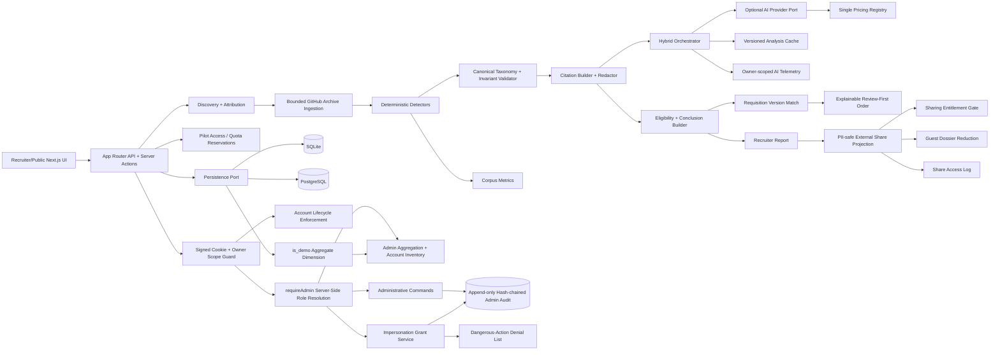

# Technical Design: CodeProof Audit Remediation

## 1. Overview

This design evolves CodeProof in place. It preserves the current Next.js 16/React 19/TypeScript application, App Router API boundaries, bounded archive ingestion, deterministic analysis, signed-cookie authentication, optional server-side AI provider, and `node:sqlite`/`pg` persistence selection. New behavior is additive and versioned; repository source remains untrusted text and is never executed.

The release creates one auditable chain:

`discovery -> attribution -> bounded revision -> detector finding -> canonical capability -> citation -> eligible conclusion -> requisition-bound comparison -> human review`

Every derived result carries the versions and provenance needed to explain or recompute it. Provider failure, absent credentials, absent current pricing, exhausted quota, or invalid AI output always returns the deterministic result rather than blocking the recruiter journey.

### 1.1 Normative reconciliation

The requirements define the authoritative canonical values. All new storage, TypeScript, API, fixtures, reports, and documentation use exactly:

```ts
export type AttributionStatus =
  | "unverified"
  | "candidate_claimed"
  | "verified_owner"
  | "verified_contributor";

export type DiscoveryOrigin =
  | "CV"
  | "portfolio"
  | "GitHub profile"
  | "manual entry";
```

No `unknown_contributor`, `unverified_contributor`, `cv_link`, `recruiter_entry`, `profile_discovery`, or `git_provider` value is written by the remediation release. Legacy values are accepted only by migration/read adapters and mapped conservatively as described in section 10.

A manually entered repository always starts as `unverified`. `candidate_claimed` records an assertion found in candidate-supplied CV or portfolio material; it does not verify authorship. `verified_owner` confirms that an authenticated provider identity owns or controls the repository but does not prove implementation authorship. Only `verified_contributor` evidence tied to authenticated identity, repository identity, and immutable revision is eligible for candidate skill conclusions, role matching, comparison factors, or Review-First Order. All other statuses may be analyzed and displayed, but are excluded from candidate scoring and conclusions.

The administration, sharing, and verification requirements add the following canonical values. They are the only values written by the remediation release, and they are shared verbatim by storage, TypeScript, Zod schemas, API projections, fixtures, and translations:

```ts
export type AccountRole = "RECRUITER" | "ADMIN";

export type AccountLifecycleState = "active" | "suspended" | "soft_deleted";

export type ShareExpiryOption = "24h" | "7d" | "30d";

export type DefectSeverity = "critical" | "high" | "medium" | "low";

export type AggregatePopulation = "real" | "demo" | "combined";

export type DangerousImpersonatedActionCategory =
  | "password_change"
  | "email_change"
  | "authentication_method_change"
  | "billing_change"
  | "payment_method_change"
  | "plan_purchase"
  | "account_ownership_transfer"
  | "account_deletion"
  | "admin_role_change"
  | "provider_credential_change"
  | "secret_disclosure";
```

`RECRUITER` is the default role for every existing and newly registered account; `ADMIN` is granted only by the initialization bootstrap described in section 4.10 or by an audited administrative role change performed by an existing Admin Actor. `active` is the default lifecycle state for every existing and newly registered account. `7d` is the default Share Expiry Option when a recruiter omits a selection. No other role, lifecycle, expiry, severity, population, or dangerous-action value is written, and legacy rows that predate these columns read as `RECRUITER`, `active`, and non-demo.

### 1.2 Goals

- Establish defensible attribution and discovery provenance without suppressing useful unverified analysis.
- Normalize capabilities and evidence levels through one versioned taxonomy and reject contradictions before persistence.
- Preserve detector, repository, revision, file, symbol, line, excerpt, and source-link grounding.
- Gate interview prompts by attribution and evidence context.
- Bound, schema-validate, meter, price, cache, and observe optional AI behind one provider interface.
- Make ingestion, success/failure, attribution, denominator, and bounded-corpus metrics exact.
- Save comparisons against immutable requisition versions and produce explainable, human-controlled review order.
- Provide reduced, revocable, non-indexed external reports without exposing private workspace data.
- Deliver recruiter-first English/Arabic, LTR/RTL, responsive, accessible public and authenticated experiences.
- Apply additive, idempotent, atomic inline upgrades on SQLite and PostgreSQL.
- Gate launch on synthetic regression/E2E coverage and same-commit Vercel preview/production verification while retaining Replit compatibility documentation.
- Enforce an internal administration role from server-side account state on every request, bootstrapped only from an environment variable that elevates an already-registered account.
- Record every administrative action, impersonation event, and administrative denial in an append-only hash-chained audit log whose append failure aborts the action.
- Operate accounts, plans, credits, demo data, and external shares from one responsive bilingual Admin Console instead of direct database access.
- Reproduce a customer's view through a bounded, audited, credential-free impersonation grant with a persistent return control and a server-side dangerous-action denial list.
- Restrict external sharing to an entitled owner and reduce guest access to exactly one read-only candidate dossier.
- Carry one `is_demo` dimension through analytics, cost, and billing aggregates so real business totals never include demonstration activity.
- Drive completion through a verification loop that fixes defects instead of weakening acceptance criteria, gated by two consecutive clean release passes and production commit equivalence.

### 1.3 Non-goals

- Executing repository code, package managers, builds, tests, hooks, macros, containers, or commands.
- Cloning private repositories or persisting Git-provider credentials.
- Automatically rejecting, advancing, or hiring candidates.
- Treating missing evidence as negative evidence.
- Introducing checkout, invoicing, payment collection, renewals, or a billing provider.
- Replacing the established application, authentication, ingestion, or dual-database architecture.
- Creating an administrative account, credential, invitation, recovery path, or self-service elevation route.
- Revealing, setting, or changing any account password, password hash, session credential, share token, or provider key through the Admin Console or an Impersonation Session.
- Hard-deleting account data; administrative removal is soft-delete with preserved ownership and restore.
- Implementing the enterprise sharing capabilities themselves; the release defines entitlement-gated seams that deny closed.
- Weakening, deleting, disabling, or rewriting any acceptance criterion to make a check pass.

## 2. Repository Findings and Compatibility Constraints

The current repository already provides useful seams:

- `src/services/github/client.ts` validates GitHub URLs, downloads bounded ZIP archives, rejects unsafe entries, detects languages, and selects text without repository execution.
- `src/features/repository-analysis/deterministic.ts`, `engine.ts`, and `evidence-scoring.ts` provide deterministic analysis, versioning, and threshold caps.
- `src/services/ai/provider.ts` defines an optional provider interface, while `schema.ts` uses strict Zod schemas and `openai-provider.ts` delimits untrusted repository/CV/job text.
- `src/features/repository-analysis/cache.ts` has memory/filesystem/PostgreSQL cache implementations.
- `src/features/auth/session.ts` signs expiring cookies with HMAC-SHA256, uses secure production attributes, and resolves a server-side user.
- candidate, authentication, and requisition stores select PostgreSQL when `DATABASE_URL`/`POSTGRES_URL` exists and otherwise use SQLite. Schema creation and upgrades occur inline during store initialization.
- current analyses are stored as JSON plus summary columns. Existing title-cased evidence levels and aggregate `evidence_index` fields require compatibility adapters rather than destructive rewrites.
- the current OpenAI default model string is not assumed to have official pricing. Under this design, an unregistered model is disabled for paid requests rather than assigned guessed pricing.

Findings that specifically shape the administration, impersonation, sharing, and demo-isolation work:

- `src/features/auth/store.ts` owns the account table under two names: `users` in SQLite and `codeproof_users` in PostgreSQL, each with `id`, `email UNIQUE`, `password_hash`, `created_at`, and each created inline by `CREATE TABLE IF NOT EXISTS` during store initialization. Role, lifecycle, demo, and company columns are therefore additive `ALTER TABLE ADD COLUMN` changes on an existing table rather than a new account model, and `AuthPersistence` already abstracts both adapters behind `findByEmail`/`findById`/`createUser`.
- `hashPassword`/`verifyPassword` in the same module already implement `scrypt$salt$key` with `timingSafeEqual`. Share passcodes reuse this exact function pair so the release contains one password-hash implementation rather than two.
- `src/features/auth/session.ts` signs `userId.expiry.signature` with HMAC-SHA256 and resolves the account with `getAuthStore().findById(userId)` on every call. The cookie carries no role, plan, or permission claim, so per-request database role resolution is the natural extension and no cookie format change is needed.
- `src/features/auth/guard.ts` (`authenticateRequest`, `denyCrossOrigin`) and `src/features/auth/page-guard.ts` (`requirePageUser`) are the two established authorization seams; administrative guards are added beside them rather than in middleware, so a browser request, a `curl` call, and a script all traverse the same handler-level check.
- `src/features/auth/rate-limit.ts` already implements a hashed-key sliding window with a bounded tracked-key map. Administrative denial limiting and share passcode limiting reuse this shape instead of inventing a second limiter.
- `src/app/layout.tsx` already awaits `getCurrentUser()` and wraps every route in `AppShell`, and `AppShell` renders distinct signed-in and signed-out shells. An impersonation banner mounted in the root layout above both shells is therefore present on every rendered route by construction.
- `candidates.is_demo` already exists in `src/features/candidates/store.ts`, and `src/app/page.tsx`, `src/app/insights/page.tsx`, `src/app/candidates/page.tsx`, `src/features/review-queue/queue.ts`, and `src/app/candidates/[id]/share/page.tsx` already split real from demo populations. The account-level `is_demo` dimension extends an established pattern rather than introducing one, and the existing `Badge tone="warning"` demo label is the reusable labeling primitive.
- `src/services/observability/logger.ts` writes structured single-line JSON with a fixed field filter, which is the redaction boundary for administrative diagnostics.
- `src/app/api/health/route.ts` already returns readiness, engine version, persistence mode, and timestamp, and already degrades rather than throws. Commit SHA and build date are additive non-secret fields on this existing contract.
- `.env.example` documents `CODEPROOF_SESSION_SECRET`, `DATABASE_URL`/`POSTGRES_URL`, and `CODEPROOF_ALLOW_SIGNUP`. `ADMIN_EMAIL` joins that documented set as a server-only variable with no default value and no client exposure.
- there is no `/admin` route, no `/share` route, no external share table, and no administrative API today, so these are new additions rather than replacements; `src/app/candidates/[id]/share/page.tsx` is an authenticated print view, not a guest surface, and is not repurposed as one.

The remediation layer therefore adds domain modules and sidecar tables, keeps legacy columns readable, and exposes versioned response projections. Existing pre-release requests continue to work with safe defaults.

## 3. Architecture



### 3.1 Module boundaries

| Module | Responsibility | Never does |
|---|---|---|
| Discovery/Attribution | records exact origin, status, verification events, staleness | infers authorship from repository presence |
| Archive ingestion | URL validation, transport/decompression/path/file/byte bounds, text selection, stage metrics | checkout, execute, install, build, test |
| Deterministic detectors | facts, capabilities, files, symbols, lines, excerpts | make provider-dependent conclusions |
| Taxonomy | aliases, relationships, evidence thresholds, contradiction validation | mutate completed taxonomy versions |
| Citation/redaction | immutable source grounding, source links, bounded exact excerpts, safe projection | generate unsupported source text |
| Hybrid analysis | deterministic-first orchestration, cache, provider schema gate, fallback | let AI overwrite deterministic facts |
| Pricing/telemetry | one versioned price source, estimates, actuals, owner-scoped events | interpret absent usage as zero |
| Requisition comparison | immutable role snapshot, neutral gaps, explainable deterministic order | change workflow state |
| External share | digest-only tokens, expiry/revocation/rate limit, allowlisted report | expose private APIs or internal notes |
| Pilot access | atomic reservation, exactly-once commit/release, entitlements | process payment |
| Persistence | parity across SQLite/PostgreSQL and inline additive migration | destructive schema replacement |
| Admin authorization | per-request role resolution from account state, non-disclosing denial, denial rate limiting | trust a role claim from cookie, body, query, header, or client state |
| Admin bootstrap | idempotent elevation of one already-registered address | create an account, credential, invitation, or recovery path |
| Administrative audit | append-only hash-chained entries with before/after values and request metadata | update, overwrite, delete, or store an unredacted secret |
| Administrative commands | lifecycle, plan, credit, demo, share-revocation, provider-mediated password reset | hard-delete data, reassign ownership, or return a credential |
| Admin aggregation | real and demo totals with explicit period, denominator, and rounding | substitute zero for an unavailable source |
| Impersonation | separate signed short-lived grant, banner on every route, safe restoration | mutate the admin session cookie or touch a credential |
| Guest dossier | constructive allowlist projection of exactly one candidate report | expose another candidate, account capability, export, AI action, or mutation |
| Demo isolation | write-time `is_demo` designation carried into every aggregate | retroactively rewrite persisted telemetry or usage rows |
| Verification harness | loop ledger, severity triage, release-gate counter, disclosure of blocked checks | weaken a criterion, skip an assertion, or claim an unexecuted check passed |

## 4. Core Domain Model

### 4.1 Repository discovery and contribution verification

```ts
interface CandidateRepository {
  id: string;
  ownerUserId: string;
  candidateId: string;
  repositoryUrl: string;
  repositoryOwner: string;
  repositoryName: string;
  discoveryOrigin: DiscoveryOrigin;
  attributionStatus: AttributionStatus;
  attributionUpdatedAt: string;
  verificationRevision: string | null;
  linkedProviderIdentityId: string | null;
  originConfirmationRequired: boolean;
}

interface ContributionVerificationEvent {
  id: string;
  candidateRepositoryId: string;
  fromStatus: AttributionStatus;
  toStatus: AttributionStatus;
  provider: string | null;
  providerIdentityFingerprint: string | null;
  repositoryProviderId: string | null;
  immutableRevision: string | null;
  reason:
    | "candidate_source_claim"
    | "provider_owner_confirmed"
    | "provider_contribution_confirmed"
    | "verification_stale"
    | "legacy_backfill"
    | "recruiter_confirmed_origin";
  verifiedAt: string | null;
  createdAt: string;
}
```

Default status by discovery does not imply contribution:

| Origin | Initial status | Reason |
|---|---|---|
| `CV` | `candidate_claimed` when the URL is actually present in candidate-supplied CV; otherwise `unverified` | explicit candidate source claim only |
| `portfolio` | `candidate_claimed` when the portfolio was itself candidate-linked; otherwise `unverified` | association is not provider verification |
| `GitHub profile` | `unverified` | public profile discovery does not authenticate the candidate |
| `manual entry` | `unverified` | authoritative manual-entry default |

Provider transitions are monotonic only while their verification tuple remains current. Complete contributor proof yields `verified_contributor`; ownership proof without immutable contribution proof yields `verified_owner`; incomplete proof does not elevate. A change in linked identity, repository provider ID, or analyzed revision marks the verification event stale and returns the active status to `unverified`. Historical events remain append-only for audit.

Provider credentials exist only in request-local server memory or provider SDK credential storage. They are redacted at logger boundaries and never enter domain records, cache keys, telemetry payloads, serialized errors, or client responses.

### 4.2 Canonical capability taxonomy

The taxonomy is an immutable, versioned registry loaded by deterministic analysis, API projection, reports, matching, and methodology. A release includes one active version while completed analyses retain their pinned version.

```ts
type CapabilityRelation =
  | "broader_than"
  | "narrower_than"
  | "related_to"
  | "evidence_requires"
  | "incompatible_with";

interface CapabilityNode {
  id: string;                       // stable slug, e.g. web.framework.nextjs
  labels: { en: string; ar: string };
  aliases: string[];                // normalized case/spacing/package aliases
  category: "language" | "framework" | "library" | "database" |
    "testing" | "security" | "architecture" | "devops" | "domain";
  relations: Array<{ type: CapabilityRelation; targetId: string }>;
  detectorIds: string[];
}

interface TaxonomyVersion {
  version: string;
  effectiveAt: string;
  nodes: CapabilityNode[];
  evidencePolicyVersion: string;
}
```

Alias normalization performs Unicode NFKC, trim, whitespace collapse, and locale-independent case folding. Within a taxonomy version, an alias resolves to exactly one node; collisions fail build-time taxonomy validation. Examples include `ts`/`typescript` -> `language.typescript`, `next`/`next.js`/`nextjs` -> `web.framework.nextjs`, and `postgres`/`postgresql` -> `data.database.postgresql`. `broader_than`/`narrower_than` form an acyclic inverse pair, `related_to` and `incompatible_with` are symmetric, and `evidence_requires` is directed. Matching may roll evidence upward to a broader capability only when the versioned relationship explicitly allows it; it never rolls broad evidence down to a narrower skill.

Canonical evidence levels are serialized as `strong`, `good`, `partial`, `limited`, and `insufficient`. A compatibility mapper renders existing title-cased labels and parses legacy JSON, but new persistence stores canonical values.

Threshold policy:

- `strong`: at least three meaningful implementation files, at least two implementation areas, and either test evidence or at least two architectural boundaries.
- `good`: at least two meaningful implementation files or repeated non-trivial use across modules.
- `partial`: one meaningful implementation example or narrow test-backed use.
- `limited`: dependencies, manifests, configuration, documentation, generated output, or trivial usage only; non-conclusive.
- `insufficient`: no eligible grounded implementation; represented as an evidence gap, never a deficiency.

Generated/vendor/build/cache paths are ineligible for meaningful implementation. A detector declares its signal class so scoring cannot promote a weak signal.

### 4.3 Findings, evidence, citations, and conclusions

```ts
interface DetectorFinding {
  id: string;
  detectorId: string;
  detectorVersion: string;
  capabilityId: string;
  signalClass: "implementation" | "test" | "architecture" |
    "dependency" | "configuration" | "documentation" | "generated" | "trivial";
  repositoryId: string;
  revision: string | null;
  filePath: string;
  symbol: string | null;
  startLine: number | null;
  endLine: number | null;
  excerptStartOffset: number | null;
  excerptEndOffset: number | null;
}

interface EvidenceCitation {
  id: string;
  findingId: string;
  detectorId: string;
  detectorVersion: string;
  repositoryId: string;
  repositoryUrl: string;
  repositoryName: string;
  revision: string | null;
  filePath: string;
  symbol: string | null;
  startLine: number | null;
  endLine: number | null;
  excerpt: string | null;
  sourceLink: string;
  discoveryOrigin: DiscoveryOrigin;
  attributionStatus: AttributionStatus;
  evidenceLevel: "strong" | "good" | "partial" | "limited" | "insufficient";
  taxonomyVersion: string;
}

interface CandidateConclusion {
  id: string;
  analysisVersionId: string;
  capabilityId: string;
  evidenceLevel: "strong" | "good" | "partial";
  citationIds: string[];
  eligibility: "eligible" | "unsupported";
  explanation: string;
}
```

Excerpts are exact source slices, never provider prose, and are capped by both line count and characters (default 12 lines/800 characters). Line spans are computed from the exact analyzed bytes. A GitHub source link uses `/blob/{immutableRevision}/{encodedPath}#Lx-Ly` only when a revision and lines are known; otherwise it links to the repository/path without claiming immutability and displays “revision unavailable.” Technical tokens remain LTR in both locales.

A conclusion is eligible only when every material claim is grounded and at least one citation has `verified_contributor`; `limited` and `insufficient` never become conclusions. Non-eligible analyses remain visible in an “association/unverified evidence” section and may support safe verification questions.

Contradiction invariants, enforced by a pure validator before persistence:

1. one evidence item has exactly one canonical level;
2. the same `(analysisVersion, candidate, capability, repository, revision, claimScope)` cannot have both an evidence gap and eligible supporting citation;
3. every eligible conclusion has a resolvable `verified_contributor` citation in the same analysis/taxonomy version;
4. aliases resolve to one canonical capability per taxonomy version;
5. a weak-signal-only item cannot exceed `limited`;
6. `strong`, `good`, and `partial` satisfy their minimum threshold;
7. citation file/revision/span belongs to the analyzed corpus and source link;
8. report/comparison/share projections preserve status, origin, level, and taxonomy version;
9. completed analysis and requisition versions are immutable;
10. selected/success/failed and attribution totals reconcile as described below.

### 4.4 Context-safe interview questions

```ts
type QuestionBasis =
  | { kind: "evidence"; citationIds: string[] }
  | { kind: "gap"; missingCapabilityId: string };

interface InterviewQuestion {
  id: string;
  analysisVersionId: string;
  basis: QuestionBasis;
  attributionGate: AttributionStatus;
  question: string;
  redactionApplied: boolean;
}
```

Gates are applied after deterministic/provider generation and before persistence:

- `verified_contributor`: implementation-specific question may reference the citation without asserting more than the verified contribution scope.
- `verified_owner`: ask what the candidate personally contributed and how responsibilities were divided; do not attribute cited code as theirs.
- `candidate_claimed`: ask the candidate to verify the relationship and identify their contribution before technical follow-up.
- `unverified`: only neutral ownership/context verification or an explicit gap-based question.
- gap-based questions identify the missing canonical capability and say that visible evidence was insufficient.

Secret-like values, authentication data, contact details, and protected-trait inferences are redacted from question text and excerpts. If safe rewriting cannot preserve meaning, the question is dropped. External reports omit any excerpt that fails the public PII/secret allowlist.

### 4.5 Exact repository and attribution metrics

```ts
interface RepositoryCorpusMetrics {
  rawArchiveEntryCount: number;
  eligibleTextFileCount: number;
  selectedFileCount: number;
  analyzedFileCount: number;
  downloadedArchiveBytes: number;   // compressed transport bytes
  eligibleTextBytes: number;        // decoded eligible text bytes
  selectedTextBytes: number;
  analyzedTextBytes: number;
  excludedByReason: Record<string, { files: number; bytes: number }>;
  limits: Record<string, number>;
}

interface RepositoryRunMetrics {
  selectedRepositoryCount: number;
  successfulRepositoryCount: number;
  failedRepositoryCount: number;
  pendingRepositoryCount: number;
  attributionCounts: Record<AttributionStatus, number>;
}
```

For a completed batch, `selectedRepositoryCount = successfulRepositoryCount + failedRepositoryCount`; while running, pending is included. Attribution counts sum to the number of selected candidate-repository relationships. “Attribution coverage” displays `verified_contributor / selected` with numerator, denominator, and rounding rule. It does not combine `verified_owner` with contributor verification.

File invariants are `analyzed <= selected <= eligible <= raw entries`; byte invariants are `analyzedTextBytes <= selectedTextBytes <= eligibleTextBytes`. Compressed archive bytes are a different unit and are not ordered against decoded text bytes. Language metrics include corpus stage and denominator. Evidence metrics include eligible population, level weights, attribution filter, numerator, denominator, and rounding rule. Missing GitHub stars/issues/pull requests/contributors/listings serialize as `null`/`unavailable`, never zero. Repository-wide facts are omitted unless archive/provider metadata actually supplies them.

### 4.6 Requisitions, comparisons, and Review-First Order

```ts
interface RequisitionVersion {
  id: string;
  ownerUserId: string;
  requisitionId: string;
  version: number;
  criteria: Array<{ id: string; capabilityId: string; importance: "required" | "preferred" | "context" }>;
  contentHash: string;
  createdAt: string;
}

interface SavedComparison {
  id: string;
  ownerUserId: string;
  requisitionVersionId: string;
  candidateAnalysisVersionIds: string[];
  result: ComparisonResult;
  createdAt: string;
}

interface ReviewOrderEntry {
  candidateId: string;
  analysisVersionId: string;
  factors: Array<{ criterionId: string; level: string; citationIds: string[] }>;
  uncertainties: Array<{ criterionId: string; reason: "evidence_gap" | "unverified_only" }>;
  stableTieBreakKey: string;
}
```

The comparison command loads the requisition through `(ownerUserId, requisitionVersionId)` before loading candidates. Criteria with no eligible evidence are `unknown`, contribute zero positive points, and incur no negative penalty. Factors use only `verified_contributor` citations. Review order is a saved draft, not a workflow decision. Ordering is deterministic by configured positive criterion weights and evidence levels; ties use the stable comparison inclusion ordinal and then opaque candidate UUID. Neither key contains name, age, nationality, gender, or another protected trait. Every position exposes criteria, positive evidence, uncertainties, and citations.

Evidence-checked marks key `(ownerUserId, candidateId, analysisVersionId, requisitionVersionId)`. A new analysis version makes the previous mark non-current without deleting audit history. Only a separate authorized recruiter mutation may change candidate workflow state.

### 4.7 Provider-neutral AI, one pricing registry, and telemetry

```ts
interface AiProviderV1 {
  readonly providerId: string;
  readonly modelId: string;
  execute<TInput, TOutput>(request: {
    operation: AiOperation;
    schemaVersion: string;
    input: TInput;
    signal: AbortSignal;
  }): Promise<{ output: unknown; usage: ProviderUsage | null; requestId: string | null }>;
}

interface PricingEntry {
  providerId: string;
  modelId: string;
  currency: "USD";
  units: "per_1m_tokens";
  inputMicros: string;
  cachedInputMicros: string | null;
  outputMicros: string;
  effectiveAt: string;
  checkedAt: string;
  officialSourceUrl: string;
  registryVersion: string;
}
```

`PricingRegistry` is the only price authority used by estimation, budget checks, actual-cost calculation, UI, and telemetry. Decimal integer micros avoid floating-point currency errors. Entries are release-reviewed metadata, not scraped at request time. The current primary provider must be checked against the [official OpenAI API pricing page](https://openai.com/api/pricing/) and enabled only when the configured model has a matching current registry entry. The present repository’s speculative/unregistered default model receives no guessed price and therefore falls back deterministically until an operator configures a documented model and reviewed entry. Pricing-page content is intentionally not copied into this design because model prices change; each registry row pins the checked/effective dates and source used for that release. Content derived from the pricing source is rephrased for licensing compliance.

Hybrid orchestration:

1. finish deterministic analysis and invariant validation;
2. normalize inputs and compute a cache key containing corpus digest, deterministic version, provider/model, prompt, AI schema, taxonomy, redaction, and pricing versions;
3. return an unexpired schema-valid cache hit without reserving paid usage;
4. require configured provider, current registry entry, entitlement, and budget/quota reservation;
5. calculate estimated cost from bounded expected input/output usage;
6. skip if the estimate exceeds the remaining limit;
7. execute with an effective timeout of at most 60 seconds and no more than two retries after the initial request for explicitly transient errors; non-transient errors do not retry;
8. strictly validate output with Zod, re-ground all claims to existing citation IDs, enforce attribution/question gates, and discard invalid/unsupported additions;
9. calculate actual cost from provider-reported usage and the pinned pricing row, or store `null` with `actualCostStatus: "unavailable"`;
10. commit or release the usage reservation exactly once and persist telemetry for every terminal state.

```ts
interface AiTelemetryRecord {
  id: string;
  ownerUserId: string;
  operation: AiOperation;
  providerId: string | null;
  modelId: string | null;
  status: "success" | "failed" | "fallback" | "skipped";
  fallbackReason: string | null;
  latencyMs: number;
  cacheStatus: "hit" | "miss" | "not_applicable";
  attemptCount: number;
  inputUnits: number | null;
  cachedInputUnits: number | null;
  outputUnits: number | null;
  estimatedCostMicros: string | null;
  actualCostMicros: string | null;
  actualCostStatus: "available" | "unavailable";
  currency: "USD" | null;
  pricingVersion: string | null;
  schemaVersion: string;
  promptVersion: string;
  taxonomyVersion: string;
  createdAt: string;
}
```

Telemetry contains hashes/identifiers and counts, not CV text, repository source, prompts, provider credentials, share tokens, or candidate contact details.

### 4.8 Pilot access

At least two stable tier IDs (for example `pilot_core` and `pilot_team`) map to translated display metadata, named entitlements, and period quotas for candidates, repository analyses, paid AI, active shares, and recruiter seats. Public presentation describes pilot access and limits, not future billing commitments.

A metered command atomically creates a reservation using an idempotency key. In one transaction, committed plus active reserved usage must not exceed the limit. Success commits once; failure before a retained/billable result releases once; timed-out reservations expire through reconciliation. SQLite uses `BEGIN IMMEDIATE`; PostgreSQL uses a row lock/atomic conditional update. No payment fields or routes are introduced.

### 4.9 Audit-specific canonicalization, projections, and scenario contracts

The taxonomy includes a canonical `engineering.testing` node with explicit aliases `Testing` and `Automated testing`, plus narrower `engineering.testing.unit` and `engineering.testing.integration` nodes reached by `unit`/`unit testing` and `integration`/`integration testing`. General testing evidence may roll up to `engineering.testing`, but evidence for one narrower type never proves the other. A canonical `delivery.ci_cd` node accepts `CI/CD` and maps `GitHub Actions` only when a parsed workflow contains meaningful executable job structure such as non-empty jobs, triggers, runners, and steps/actions. File presence, an empty YAML object, a documentation mention, or a dependency-only signal remains `limited` or `insufficient` and cannot prove CI/CD.

Canonical citations preserve detector ID/version, repository ID/name/URL, revision or explicit unavailable state, file, optional symbol, optional line range, bounded exact safe excerpt, direct source link, origin, attribution, evidence level, and taxonomy version. Immutable revision and line data produce a direct encoded GitHub blob/line URL; missing data produces the most specific safe link plus an explicit availability label. The question context gate treats a Flask `schema.sql` as database evidence only: absent Flask route/application-handler evidence, it cannot produce a Flask HTTP-flow conclusion or question and instead yields a neutral route-evidence gap.

Repository run projections expose selected, successful, failed, and pending counts and each exact attribution status count. A completed run satisfies `selected = successful + failed`; an active run satisfies `selected = successful + failed + pending`; exact attribution counts sum to selected Candidate-Repository relationships. UI may additionally show a grouped verified total, but it never hides the separate `verified_owner` and `verified_contributor` values or treats ownership as contribution.

Comparison creation recomputes every candidate against one selected immutable Requisition Version. A factor or saved result carrying another requisition version is rejected as `REQUISITION_VERSION_MISMATCH`; it is never merged into the selected comparison. Missing or ineligible evidence is worded as “unknown,” “not verified,” “not available,” or “not enough visible evidence,” never as candidate deficiency or proof that a skill is absent.

Signed-out share access is a first-class public flow: a valid unexpired grant renders the localized report without recruiter authentication, while invalid, expired, and revoked grants return the same localized non-disclosing unavailable contract and never redirect to sign-in.

A route inventory test covers every existing and added user-facing route: `/`, `/signin`, `/analyze`, `/candidates`, `/candidates/[id]`, `/candidates/[id]/projects/[analysisId]`, `/candidates/[id]/share`, `/compare`, `/review`, `/requirements`, `/insights`, `/about`, `/methodology`, `/pilot`, and `/share`. Each route is covered in English/LTR and Arabic/RTL, with keyboard/accessibility semantics and responsive behavior at the required mobile/tablet/desktop widths; parameterized routes use synthetic IDs.

The pricing registry drives both historical request cost and a configurable planning projection:

```ts
interface AiCostProjectionAssumptions {
  providerId: string;
  modelId: string;
  candidateVolume: number;
  repositoriesPerCandidate: number;
  aiOperationsPerCandidate: number;
  expectedInputUnitsPerOperation: number;
  expectedCachedInputUnitsPerOperation: number;
  expectedOutputUnitsPerOperation: number;
  cacheHitRate: number;
}

interface AiCostProjection {
  pricingRegistryVersion: string;
  pricingEffectiveAt: string;
  pricingCheckedAt: string;
  officialSourceUrl: string;
  costPerCandidateMicros: string;
  costPer100CandidatesMicros: string;
  projectedVolumeCostMicros: string;
  currency: "USD";
  roundingRule: string;
}
```

Projection arithmetic uses the same integer-micro, provider/model-specific primary-source pricing row as request estimates. Defaults are configuration, not claims of measured usage. Changing assumptions recomputes projections deterministically and never rewrites actual telemetry. The UI exposes provider, model, source link, effective/check dates, unit costs, assumptions, cost per Candidate, and cost per 100 Candidates.

Build metadata explicitly includes release commit SHA and build/release date in addition to build ID, environment, and verification timestamp. Production omission degrades readiness and enters Release Disclosure.

Regression fixtures preserve the repository's established exact demo contract. Network-enabled immutable-revision smoke checks use `sindresorhus/is`, `chalk/chalk`, and `sindresorhus/p-limit` only as bounded non-executed text; recorded revisions prevent moving-default-branch assertions. Synthetic flows cover the sample CV discovering `sindresorhus/is`, portfolio confirmation of `sindresorhus/p-limit`, a second Demo-labeled Candidate using `chalk/chalk` plus an unavailable portfolio, neutral PostgreSQL unknown evidence, testing and CI/CD alias boundaries, same/mismatched requisitions, signed-out share lifecycle, and no-provider deterministic fallback. If network, provider, PostgreSQL, browser, Vercel, or deployment prerequisites are absent, the exact check is externally unverifiable rather than silently replaced or passed.

### 4.10 Administration role, bootstrap, and authorization

#### Account role and state columns

The Admin Role is an additive column on the existing account table rather than a new identity system. `src/features/auth/store.ts` gains a shared `ensureAccountSchema()` that runs inside the same inline initialization already used by `AuthStore`'s constructor and `PostgresAuthStore.initialize()`:

| Column | SQLite (`users`) | PostgreSQL (`codeproof_users`) | Default for legacy rows |
|---|---|---|---|
| `role` | `TEXT NOT NULL DEFAULT 'RECRUITER'` | `TEXT NOT NULL DEFAULT 'RECRUITER'` | `RECRUITER` |
| `lifecycle_state` | `TEXT NOT NULL DEFAULT 'active'` | `TEXT NOT NULL DEFAULT 'active'` | `active` |
| `is_demo` | `INTEGER NOT NULL DEFAULT 0` | `BOOLEAN NOT NULL DEFAULT FALSE` | non-demo |
| `demo_label` | `TEXT` | `TEXT` | `NULL` |
| `company_name` | `TEXT` | `TEXT` | `NULL` |
| `plan_tier_id` | `TEXT` | `TEXT` | `NULL`, resolved to the default pilot tier |
| `last_activity_at` | `TEXT` | `TIMESTAMPTZ` | `NULL`, presented as unavailable |
| `soft_deleted_at` | `TEXT` | `TIMESTAMPTZ` | `NULL` |
| `suspended_at` | `TEXT` | `TIMESTAMPTZ` | `NULL` |

Parity rules, because the two engines do not offer the same constraint surface:

- PostgreSQL adds named `CHECK` constraints for `role` and `lifecycle_state`, created only when `pg_constraint` does not already contain the name, so repeated initialization is idempotent.
- SQLite cannot attach a `CHECK` through `ALTER TABLE ADD COLUMN`. Parity is preserved by three mechanisms instead: one shared Zod enum (`AccountRoleSchema`, `AccountLifecycleStateSchema`) validating every write, a write-path assertion in the store that rejects a non-canonical value before the statement executes, and a startup validation query that fails readiness when any persisted row holds a non-canonical value. The dual-adapter contract suite asserts that both engines reject the same generated invalid values with the same error code.
- `AuthUser` gains `role`, `lifecycleState`, `isDemo`, `demoLabel`, and `companyName`. `AuthUserWithPassword` remains the only type carrying `passwordHash`, and no administrative or impersonation read path uses it. Every administrative query names its columns explicitly; `SELECT *` is not used on the account table outside `findByEmail`, which exists solely for credential verification.

#### Idempotent ADMIN_EMAIL bootstrap

`ensureAdminBootstrap()` runs once per process during the same initialization that applies the schema, after `ensureAccountSchema()` and inside the same transaction and lock (SQLite `BEGIN IMMEDIATE`; PostgreSQL the transaction-scoped advisory migration lock from section 10.2). It never inserts a row:

```sql
UPDATE users
   SET role = 'ADMIN'
 WHERE lower(trim(email)) = lower(trim(:adminEmail))
   AND role <> 'ADMIN';
```

Properties of this design:

- **Elevation only.** The statement is an `UPDATE` with an email predicate. No code path in the bootstrap creates an account, writes `password_hash`, issues a reset, or sends an invitation. An `ADMIN_EMAIL` value that matches nothing leaves the platform with no Admin Role.
- **Idempotent.** The `role <> 'ADMIN'` predicate makes a repeat run affect zero rows, and the single-statement conditional update is atomic on both engines, so concurrent instances cannot double-apply or interleave. Running initialization any number of times yields the same account count and the same role set.
- **Credential-neutral.** `password_hash`, `created_at`, and every other column are untouched, so the owner signs in with the password the account already had.
- **Unresolved bootstrap is visible, not silent.** When the variable is absent, empty after trimming, or matches no account, the platform starts with no Admin Role and `logger.warn("admin_bootstrap_unresolved", { reason, emailDigestPrefix })` records one redacted diagnostic. `reason` is `variable_absent | variable_empty | no_matching_account`; `emailDigestPrefix` is the first 8 hex characters of `SHA-256(normalizedEmail)` and is present only for `no_matching_account`. The address itself is never logged.
- **Divergence is reported, not silently corrected.** If an `ADMIN` account exists whose email no longer matches the variable, bootstrap neither demotes it nor elevates a second account; it records `admin_bootstrap_divergence` with digest prefixes and surfaces the condition in authorized diagnostics. Demotion is only ever an audited administrative role change.
- `ADMIN_EMAIL` is documented in `.env.example` with an empty value, is read only in server modules, and is never referenced from a client component, so it cannot reach a client bundle. No administrative address, password, hash, token, or recovery credential appears in source, configuration defaults, Synthetic Fixtures, or client bundles; a tracked scan enforces this.

#### The requireAdmin guard

```ts
interface AdminActor {
  userId: string;
  email: string;
  role: "ADMIN";
  lifecycleState: "active";
}

type AdminDenialReason =
  | "no_session"
  | "not_admin"
  | "account_unavailable"
  | "impersonation_active"
  | "rate_limited";

// src/features/auth/admin-guard.ts
async function requireAdmin(request: Request): Promise<AdminActor>;      // throws AdminAccessDenied
async function requireAdminPage(): Promise<AdminActor>;                   // calls notFound() on denial
function adminApiDenial(): Response;                                      // shared 404 envelope
```

Resolution order on **every** request, with no cached decision and no cross-request memoization:

1. read the session cookie and verify signature and expiry with the existing `readSessionToken()`;
2. load the account row by id through `getAuthStore()`, selecting `id, email, role, lifecycle_state, is_demo` explicitly;
3. require `lifecycle_state = 'active'`;
4. require `role = 'ADMIN'` as read from that row;
5. require that no impersonation grant is active for the request (section 4.12);
6. check the administrative denial limiter.

Because the session cookie payload is only `userId.expiry.signature`, there is no role claim to trust and no claim to forge. Any `role`, `isAdmin`, `permissions`, or `adminToken` field arriving in a cookie, request body, query string, header, or client-submitted form state is discarded: administrative request schemas are `z.object({...}).strict()`, and a shared `rejectPrivilegeClaimKeys()` runs first and returns the standard unavailable envelope when a reserved key is present, so an injected claim cannot even reach validation. The effective role is a pure function of the persisted row.

Non-disclosing denials. Every denial returns the same response as a nonexistent resource, so an unauthenticated visitor, a signed-in non-admin, a rate-limited requester, and a request for a genuinely absent record are indistinguishable:

| Surface | Denial behavior |
|---|---|
| `/admin` pages and layouts | `notFound()`, rendering the standard `src/app/not-found.tsx` 404, never a sign-in redirect and never an "administration" hint |
| administrative API routes | HTTP 404 with the shared `{ error: { code: "RESOURCE_UNAVAILABLE" } }` envelope, identical body, headers, and shape to an absent record |
| administrative server actions | the same `RESOURCE_UNAVAILABLE` result, so the form path cannot be used to probe existence |

Nothing in a denial names the Admin Console, an administrative data shape, an account, or the reason. The reason is recorded in the audit log and in a redacted diagnostic only.

Guard placement. `src/app/admin/layout.tsx` calls `requireAdminPage()` so every nested page inherits it, and **each** `page.tsx` and **each** `src/app/api/admin/**/route.ts` handler calls the guard itself. The redundancy is deliberate: a Next.js layout does not run for route handlers, and a layout is not an authorization boundary for direct API access. The guard runs in the handler rather than in middleware, so a browser request, a command-line tool, a script, and a direct API call traverse one identical code path; a route-inventory test asserts every administrative route module imports the guard.

Denial rate limiting. `adminAuthorizationRateLimited(request, subject)` follows the established `src/features/auth/rate-limit.ts` shape: key `SHA-256(forwardedIp + ":" + (sessionUserId ?? "anonymous") + ":admin")`, 15-minute window, threshold `CODEPROOF_ADMIN_DENIAL_THRESHOLD` (default 10). Past the threshold the guard returns the same unavailable envelope without reading the database, so a probe becomes cheaper to refuse than to answer. The in-memory window is per-instance, which is insufficient on a serverless host, so PostgreSQL deployments additionally persist counters in `admin_authorization_attempts` keyed by the same digest with a bounded window; the limiter reads the durable counter when a pool is configured and the memory counter otherwise. Successful administrative authorization clears the subject's counter.

#### Administrative audit log

```ts
interface AdminAuditEntry {
  id: string;
  sequence: number;                       // dense, monotonic, unique
  occurredAt: string;
  actorUserId: string;
  actorRole: AccountRole;
  impersonatedUserId: string | null;
  action: string;                         // e.g. account_suspend, credit_adjust, impersonation_start
  actionCategory: string;
  targetKind: "account" | "share" | "candidate" | "analysis" | "quota" | "impersonation_grant" | "none";
  targetId: string | null;
  outcome: "succeeded" | "denied" | "failed";
  denialReason: string | null;
  parameters: Record<string, unknown>;    // redacted, non-secret
  before: Record<string, unknown> | null;
  after: Record<string, unknown> | null;
  requestCorrelationId: string;
  requestMethod: string;
  route: string;
  ipFingerprint: string;                  // digest, not an address
  userAgentFamily: string | null;
  previousEntryHash: string;
  entryHash: string;
}
```

Hash chaining. `entryHash = SHA-256(canonicalJson(entryWithoutHash))` where canonical JSON uses lexicographically sorted keys, no insignificant whitespace, UTF-8 encoding, and preserved `null`s, and the hashed object includes `previousEntryHash`. The genesis entry uses 64 zero characters. `sequence` and `previousEntryHash` are both `UNIQUE`, so a silent re-link or a gap is detectable rather than merely unlikely. `verifyAdminAuditChain(from, to)` recomputes the chain; a mismatch is a `critical` defect, fails authorized diagnostics readiness, and is recorded in the Release Disclosure.

Insert-only enforcement uses both a storage guarantee and an interface guarantee:

- SQLite: `CREATE TRIGGER IF NOT EXISTS admin_audit_log_no_update BEFORE UPDATE ON admin_audit_log BEGIN SELECT RAISE(ABORT, 'admin_audit_append_only'); END;` plus the same trigger for `DELETE`.
- PostgreSQL: a `BEFORE UPDATE OR DELETE OR TRUNCATE` trigger raising an exception, plus `REVOKE UPDATE, DELETE, TRUNCATE` from the application role when the deployment's grants permit it. The trigger is the portable guarantee, because managed hosts commonly run the application as the table owner and a revoke alone would not bind.
- Interface: the store exposes `appendAdminAuditEntry()` and read methods only. No update or delete method exists to call from the Admin Console, an administrative API, a server action, or a migration. Migrations may add columns with defaults but never rewrite an existing row.

Secret redaction happens **before** hashing, so the chain covers exactly the bytes that are stored. `redactAdministrativeValue()` walks `parameters`, `before`, and `after` and replaces a value with `"[redacted]"` when either the key matches the denylist (`password`, `newPassword`, `passwordHash`, `password_hash`, `hash`, `token`, `shareToken`, `tokenDigest`, `passcode`, `passcodeDigest`, `secret`, `resetToken`, `verificationCode`, `apiKey`, `authorization`, `cookie`, `sessionToken`) or the value matches a secret shape (a `scrypt$` prefix, a JWT-like three-segment value, a bearer-like opaque string, or a high-entropy string above the configured length and entropy thresholds). Redaction is applied recursively and to array elements. The same function guards administrative API responses, Admin Console view models, administrative exports, and diagnostics, so one implementation covers every surface named in the requirements.

Append failure aborts the action. Every state-changing administrative command runs through:

```ts
async function withAdminAudit<T>(
  actor: AdminActor,
  descriptor: AdminActionDescriptor,
  mutate: (tx: Transaction) => Promise<{ result: T; before: unknown; after: unknown }>,
): Promise<T>;
```

`withAdminAudit` opens one transaction (SQLite `BEGIN IMMEDIATE`; PostgreSQL a single transaction that takes `SELECT ... FOR UPDATE` on the audit chain head row to serialize `sequence` assignment), performs the domain mutation, then appends the audit entry as the last statement, then commits. If the append fails for any reason — trigger, unique violation on `sequence` or `previousEntryHash`, I/O error, serialization failure — the transaction rolls back and the command returns `ADMIN_AUDIT_APPEND_FAILED`. The target state is therefore unchanged: there is no code path that mutates account state, plan, credit, quota, demo baseline, or share validity outside this wrapper, and no path that commits a mutation before its audit entry is durable. Denied-attempt entries have no domain mutation to roll back, so they are appended on their own; if that append fails, the denial still returns the standard unavailable envelope and the failure is recorded as a redacted diagnostic, because failing open on a denial would be worse than an incomplete log.

### 4.11 Admin Console structure, aggregation, and administrative commands

#### Route structure

```
src/app/admin/layout.tsx                              guard + AdminShell + banner slot
src/app/admin/page.tsx                                dashboard metrics
src/app/admin/accounts/page.tsx                       paginated searchable account table
src/app/admin/accounts/[accountId]/page.tsx           account detail and command forms
src/app/admin/demo/page.tsx                           demo account creation and reset
src/app/admin/audit/page.tsx                          read-only paginated audit reader

src/app/api/admin/metrics/route.ts                              GET
src/app/api/admin/accounts/route.ts                             GET   search / filter / paginate
src/app/api/admin/accounts/[accountId]/route.ts                 GET   detail
src/app/api/admin/accounts/[accountId]/lifecycle/route.ts        POST
src/app/api/admin/accounts/[accountId]/plan/route.ts             POST
src/app/api/admin/accounts/[accountId]/credits/route.ts          POST
src/app/api/admin/accounts/[accountId]/demo/route.ts             POST  designate / reset
src/app/api/admin/accounts/[accountId]/password-reset/route.ts    POST
src/app/api/admin/accounts/[accountId]/shares/[shareId]/revoke/route.ts  POST
src/app/api/admin/impersonation/route.ts                         POST  start / end
src/app/api/admin/audit/route.ts                                GET
```

Admin pages are `dynamic = "force-dynamic"` so a role decision is never served from a static or shared cache, and every administrative response carries `Cache-Control: private, no-store`. `AdminShell` is a distinct shell from the recruiter `AppShell` navigation set, so administrative navigation never appears to a recruiter and administrative routes are not linked from recruiter surfaces.

#### Metric aggregation with explicit denominators

Every dashboard figure is an `AdminMetric`, never a bare number:

```ts
interface AdminMetric {
  id: string;
  value: number | string | null;         // null means unavailable, never a zero substitute
  availability: "available" | "unavailable";
  unavailableReason: "no_source_table" | "no_records_in_period" | "partial_source" | "query_failed" | null;
  population: AggregatePopulation;
  aggregateClass: "real_commercial" | "combined_operational";
  denominator: { label: string; value: number | null };
  period: { start: string | null; end: string | null; label: string };
  roundingRule: "none" | "half_up_0dp" | "half_up_1dp" | "half_up_2dp";
  coverage: { observed: number; expected: number } | null;
}
```

The dashboard set, each computed once for `population: "real"` and once for `population: "demo"` from one parameterized SQL shape:

| Metric | Numerator | Denominator | Notes |
|---|---|---|---|
| total accounts | accounts matching the population | accounts matching the population | `soft_deleted` included, labeled |
| active accounts | `lifecycle_state = 'active'` | total accounts in population | `soft_deleted` and `suspended` excluded from the numerator |
| new accounts in period | `created_at` within period | total accounts at period end | period boundary displayed |
| free-plan / paid-plan accounts | accounts per resolved `plan_tier_id` class | total accounts in population | unresolved plan counts as unavailable, not free |
| suspended accounts | `lifecycle_state = 'suspended'` | total accounts in population | |
| demo accounts | `is_demo` true | total accounts including demo | always a combined-population denominator, labeled |
| candidates analyzed | candidate records | candidates in population | reuses existing `candidates.is_demo` |
| repositories analyzed | repository outcome rows | selected repository relationships | reconciles with section 4.5 invariants |
| AI requests | `ai_telemetry` rows | requests in population | |
| billable usage totals | summed usage units | requests with usage present | requests with absent usage excluded from the denominator, not counted as zero |
| estimated cost total | summed `estimated_cost_micros` | requests with a pinned pricing row | integer micros, section 4.7 arithmetic |
| actual cost total | summed `actual_cost_micros` where `actual_cost_status='available'` | requests in population | `coverage` reports available/total so partial reporting is not read as lower spend |
| failed analysis / failed AI counts | failed rows | attempted rows | |

Query rules. Real aggregates filter on the record's stored `is_demo` (section 4.14), never on a join to the account's current designation. Conditional counting uses a parity helper rather than engine-specific syntax: `COUNT(*) FILTER (WHERE ...)` on PostgreSQL and `SUM(CASE WHEN ... THEN 1 ELSE 0 END)` on SQLite, because `FILTER` availability varies by `node:sqlite` build. Money stays in integer micros end to end. A metric whose source table is absent, whose period contains no records, or whose query fails resolves to `value: null`, `availability: "unavailable"` with a reason, and renders a translated "unavailable" label — never `0`. A metric that mixes real and demo populations is emitted with `population: "combined"` and `aggregateClass: "combined_operational"` and is labeled as an operational metric; only `population: "real"` values may be presented as a Real Commercial Aggregate.

#### Account inventory table

```ts
interface AdminAccountQuery {
  search?: string;                                    // account id, email, company name
  lifecycleState?: AccountLifecycleState;
  planTierId?: string;
  isDemo?: boolean;
  cursor?: string;                                    // opaque keyset cursor
  pageSize?: number;                                  // default 25, maximum 100
}

interface AdminAccountRow {
  id: string; email: string; companyName: string | null;
  lifecycleState: AccountLifecycleState; planTierId: string | null;
  isDemo: boolean; demoLabel: string | null;
  usageTotals: Record<string, number | null>;
  quotas: Record<string, { limit: number | null; remaining: number | null }>;
  registeredAt: string; lastActivityAt: string | null;
}
```

Ordering is `(created_at DESC, id DESC)`, a total order because `id` is unique. Pagination is keyset rather than offset: the cursor is a base64url encoding of that tuple, and the next page uses `WHERE (created_at, id) < (:cursorCreatedAt, :cursorId)`. Offset pagination would shift rows when an account registers mid-traversal and silently skip or duplicate a record; the keyset cursor makes the ordering stable under concurrent inserts. The cursor is opaque but not secret, and it is validated and rejected rather than trusted when malformed. Search is parameterized in every case: exact match on `id`, case-folded `LIKE`/`ILIKE` on `email` and `company_name`, with `%`, `_`, and the escape character escaped in user input so a wildcard cannot widen the match. Filters compose as conjunctions. `lastActivityAt` and any absent usage value render as unavailable, not zero.

Robust States reuse the established `src/components/ui/StateBlock.tsx` and `EmptyState.tsx` primitives for pending, empty, partial, denied, and unexpected states with translated copy and no stack trace or secret. A denied state inside the console can only appear after a successful `requireAdmin()`, so it describes a per-record boundary, not the console itself.

#### Account detail view

The detail view lists the account's candidates, repository analyses, requisitions, usage records, AI telemetry records, and external share records, each read with the account id as the owner scope so no foreign record can appear. Share rows show status, Share Expiry Option, expiration timestamp, passcode requirement, email-verification requirement, and Share Access Log entries. The plaintext External Share Token cannot be shown because it is never persisted (section 4.13); the `token_digest` column is excluded from the projection as well, so the view exposes neither the secret nor a value derived from it.

#### Lifecycle commands and soft-delete semantics

| From \ Command | `activate` | `suspend` | `reactivate` | `soft_delete` | `restore` |
|---|---|---|---|---|---|
| `active` | idempotent no-op | → `suspended` | rejected | → `soft_deleted` | rejected |
| `suspended` | rejected | idempotent no-op | → `active` | → `soft_deleted` | rejected |
| `soft_deleted` | rejected | rejected | rejected | idempotent no-op | → `active` |

Exactly one `lifecycle_state` is set per command, a rejected transition changes nothing and returns `ACCOUNT_STATE_TRANSITION_INVALID`, and each applied command appends an audit entry whose `before`/`after` carry the prior and new state.

Soft delete preserves ownership by construction: it writes `lifecycle_state = 'soft_deleted'` and `soft_deleted_at` on the account row and **nothing else**. No row is deleted, no `owner_user_id` is rewritten, no record is reparented to a placeholder account, and no cascade runs. Every candidate, analysis, requisition, saved comparison, review order, evidence-check mark, share, telemetry row, and usage row keeps pointing at the same account id. Restore therefore needs no reattachment step: it clears `soft_deleted_at`, sets `active`, and the prior record set becomes visible again exactly as it was. The dual-adapter suite fingerprints every owned record before soft delete and asserts an identical fingerprint after restore.

Enforcement at authentication and API boundaries, so a suspended or soft-deleted account cannot act anywhere:

- `requireActiveUser()` wraps `getCurrentUser()` and is called by `requirePageUser`, `authenticateRequest`, and `denyUnlessSignedIn`. A non-`active` account yields the translated `ACCOUNT_UNAVAILABLE` state and the session cookie is cleared on the page path, so an already-issued session stops working immediately rather than at its natural expiry.
- `POST /api/auth/login` checks lifecycle **after** password verification. Ordering matters: returning an account-unavailable message before verifying credentials would turn the login form into an account-existence oracle, so an unverified credential still receives the existing generic invalid-credentials response and only a verified credential receives the translated account-unavailable response.
- `PilotAccessService.reserve()` refuses a metered operation when lifecycle is not `active`, before any quota arithmetic.
- share resolution (`POST /api/public/shares/resolve`) resolves the owning account's lifecycle and returns the one shared unavailable envelope when the owner is not `active`, so a guest link cannot outlive its owner's suspension and cannot reveal why it stopped working.
- `soft_deleted` accounts are excluded from active-account metrics and from every customer analytic while their records remain readable to the Admin Console.

#### Plan, credit, demo, share, and password commands

- **Plan change** writes `plan_tier_id` and lets the existing Pilot Access Service resolve entitlements and quotas from the tier registry on the next evaluation. No payment field, checkout, invoice, or provider call is introduced; the command is a configuration change with an audit entry.
- **Credit and quota adjustment** persists the new limit and the new remaining value together in one transaction so an evaluation can never observe a new limit against a stale remaining value, applies to the next metered evaluation, and audits prior and new values. Reset restores the tier default.
- **Demo designation and creation** requires an Admin-supplied `demo_label` (1–80 characters, stored and rendered as supplied) and seeds the account from `src/features/demo/fixtures.ts`, a versioned Synthetic Fixture set (`demoFixtureVersion`) covering requisitions, candidates, repository analyses, evidence citations, one requisition-bound comparison, one Review-First Order, and one external share record. The fixtures are generated synthetic data and reuse the release's existing synthetic corpus, so no real person's contact data and no live repository text enters a demo account.
- **Demo reset** returns the account to that fixture baseline inside one transaction and cannot touch another account: the transaction first asserts `is_demo` on the target (`SELECT is_demo FROM users WHERE id = :id FOR UPDATE` on PostgreSQL, the same read inside `BEGIN IMMEDIATE` on SQLite) and aborts with `DEMO_RESET_TARGET_INVALID` unless it is true, and every delete and insert statement in the reseed carries `owner_user_id = :demoAccountId`. There is no unscoped statement in the reset path. Non-demo accounts are provably unchanged because no statement can match their owner id.
- **Demo labeling** renders the designation and label adjacent to demo content on administrative, recruiter-facing, and externally shared surfaces, reusing the established `Badge tone="warning"` demo pattern already present in `src/app/candidates/[id]/share/page.tsx` and `src/components/review/ReviewQueueList.tsx`, and extending it to the Admin Console rows and the guest dossier.
- **Share revocation** sets `revoked_at`, so subsequent resolution of the associated token returns the shared unavailable envelope. `share_access_log` rows are retained; the revocation path contains no delete statement against the log.
- **Password reset** is provider-mediated and secret-free. The command calls the existing authentication path's reset initiation, which mints a single-use secret, stores only its digest with an expiry, and delivers it to the account's **registered** email address. The administrative response is `{ initiated: true, deliveredToRegisteredAddress: true, expiresAt }`. The current password, the new password, the password hash, the reset secret, and any reset URL are absent from the administrative response, the Admin Console view, the audit entry (whose `parameters` record only `{ method: "provider_email_reset" }`), and the logs. No administrative path sets a password directly, and no administrative path renders a reset link, so an Admin Actor cannot learn or choose a customer credential.

State-changing method enforcement. Each command lives in a `POST`-only route module that exports no `GET`, so a read-only request receives 405 and cannot execute a state change. Admin Console forms use server actions that call `requireAdmin()` and then the same command function as the API route, so the form path and the API path share one authorization implementation, one dangerous-action check, and one audit wrapper rather than two. `denyCrossOrigin()` from the existing guard module applies to every administrative mutation.

### 4.12 Impersonation grants, denial list, banner, and restoration

#### A separate grant, never a mutated session

The admin's own session cookie is never rewritten, replaced, or re-signed. Impersonation adds a second cookie, so "return to admin" is a deletion rather than a re-authentication:

- cookie `__Host-codeproof_impersonation` in production and `codeproof_impersonation` otherwise, `HttpOnly`, `Secure` in production, `SameSite=Lax`, `Path=/`, `maxAge` equal to the remaining grant lifetime;
- payload `base64url(canonicalJson(grant)) + "." + HMAC-SHA256(canonicalJson(grant), sessionSecret() + ":impersonation.v1")`.

```ts
interface ImpersonationGrant {
  purpose: "impersonation.v1";
  grantId: string;
  adminActorUserId: string;
  targetUserId: string;
  reason: string;          // recorded, bounded to 200 characters, secret-shape redacted
  startedAt: number;
  expiresAt: number;       // always <= startedAt + 60 minutes
  auditEntryId: string;    // the impersonation_start entry in admin_audit_log
}
```

The distinct `purpose` label and the distinct signing key derivation mean a session token cannot be replayed as an impersonation grant and an impersonation grant cannot be replayed as a session, even though both derive from one configured secret.

Duration. `CODEPROOF_IMPERSONATION_MAX_MINUTES` is clamped with `min(configured, 60)`; an absent, non-numeric, zero, or negative value falls back to 15 minutes. The assigned duration is therefore never greater than 60 minutes regardless of configuration.

Server-side revocation and expiry. A signature alone is not sufficient: every request also resolves `impersonation_grants` (`grant_id`, `admin_actor_user_id`, `target_user_id`, `reason_redacted`, `started_at`, `expires_at`, `ended_at`, `end_reason`, `start_audit_entry_id`, `end_audit_entry_id`). A grant with `ended_at IS NOT NULL` or `expires_at <= now` is denied with the non-disclosing envelope and requires a new authorized grant, so a stolen or replayed cookie is useless after return or expiry. The first request that observes an expired grant closes it with `end_reason = "expired"` and appends the end audit entry; a reconciliation pass closes grants whose browser never returned, so expiry is always audited even when the tab is simply abandoned.

Principal resolution. One function replaces ad-hoc checks:

```ts
interface RequestPrincipal {
  actingUserId: string;                 // the owner scope used for reads and writes
  adminActorUserId: string | null;
  impersonation: { grantId: string; expiresAt: number; targetLabel: string } | null;
}

async function resolveRequestPrincipal(): Promise<RequestPrincipal | null>;
```

Existing owner-scoped stores keep receiving exactly one `ownerUserId`, set to `actingUserId`, so no store signature changes and the owner-scope guarantees already covered by Property 29 continue to hold unchanged. `requireAdmin()` denies while a grant is active (`denial_reason: "impersonation_active"`), so an Admin Actor cannot perform administrative actions from inside an impersonated context; the Return To Admin control must be used first. This removes the confused-deputy case where an administrative command would execute with an ambiguous acting identity.

#### Dangerous-action denial list

```ts
const DANGEROUS_IMPERSONATED_ACTIONS: readonly DangerousImpersonatedActionCategory[] = [
  "password_change", "email_change", "authentication_method_change",
  "billing_change", "payment_method_change", "plan_purchase",
  "account_ownership_transfer", "account_deletion",
  "admin_role_change", "provider_credential_change", "secret_disclosure",
];

function assertImpersonationAllowed(
  category: MutatingActionCategory,
  principal: RequestPrincipal,
): void;   // throws ImpersonationActionBlocked
```

The check runs in the command layer, beneath both the route handler and the server action, so an interface request, a direct API call, a script, and a command-line tool are denied identically with `IMPERSONATION_ACTION_BLOCKED` and a translated message naming the blocked category. Hiding or disabling a control in the UI is treated as presentation only and is never the enforcement. Every mutating command declares its `actionCategory`; the posture is deny-by-default, so a command with an undeclared category is blocked under impersonation, and a route-inventory test asserts that every mutating handler declares one — a missing declaration is a `high` defect rather than a silent allow.

Audit under impersonation. Every impersonated state-changing request appends an entry carrying both `actor_user_id` (the Admin Actor) and `impersonated_user_id` (the target), and start, end-by-control, end-by-expiry, each blocked dangerous action, and each denied non-admin attempt to create, continue, or extend a grant are all recorded.

#### Impersonation never reveals or changes credentials

Impersonation is explicitly credential-free. The grant carries only user identifiers and a reason; it never reads, stores, transmits, or derives a password, password hash, session credential, provider credential, or External Share Token. The admin does not learn the customer's password, cannot set one, and does not receive a usable customer session token — the impersonation cookie is a grant bound to the admin's own identity, not the customer's session. Every response and log on the impersonated path is built from explicitly selected columns, so `password_hash` is never in scope, and `password_change`, `authentication_method_change`, `provider_credential_change`, and `secret_disclosure` are on the denial list, so no impersonated request can alter or expose a credential either. Administrative password reset remains an Admin-Console-only, provider-mediated command that returns no secret, and it is itself blocked from an impersonated context.

#### Banner, remaining time, and safe return

`src/app/layout.tsx` already awaits `getCurrentUser()` for `AppShell`; it additionally awaits `resolveRequestPrincipal()` and renders `<ImpersonationBanner>` above the shell for **both** the signed-in and signed-out variants. Because the root layout wraps every route in the App Router, no rendered route can omit the banner, and a route-inventory property asserts banner presence across the full route set while a grant is active.

The banner renders:

- the impersonated account label wrapped in `<bdi>` so an email or company name cannot flip the surrounding direction;
- remaining time, server-rendered as whole minutes from `expiresAt` and refined by a client countdown; with JavaScript unavailable the server-rendered value still states the remaining minutes, so the banner is never blank;
- a `role="status"` `aria-live="polite"` announcement on state change, restrained so the countdown does not announce every tick;
- the Return To Admin control as a real `<button type="submit">` inside a `POST` form: reachable and operable by keyboard with a visible focus indicator, not a click-only element;
- English and Arabic text, correct direction, and WCAG 2.2 AA contrast in both locales.

At zero remaining time the banner switches to an expired state, but the countdown is never the enforcement: the next server request is denied by the grant lookup regardless of what the client displays.

Return To Admin posts to the impersonation end endpoint, which sets `ended_at` and `end_reason = "returned"`, appends the end audit entry, deletes the impersonation cookie, and redirects to `/admin`. Because the admin's session cookie was never touched, the original admin session context is restored with no re-authentication, and start-then-return is a round trip back to the exact original principal.

### 4.13 Entitlement-gated external sharing and guest dossier reduction

#### Entitlement gate on every share operation

`Entitlement.external_sharing` is the Sharing Entitlement. Create, manage, revoke, and regenerate each run the same ordered gate: authenticated session → `requireActiveUser()` → owner-scope authorization of the source candidate report → `PilotAccessService.requireEntitlement(ownerUserId, "external_sharing")`.

| Operation | Route | Denials |
|---|---|---|
| create | `POST /api/shares` | unauthenticated → shared non-disclosing envelope; entitlement absent → `ENTITLEMENT_UNAVAILABLE` |
| manage | `GET`/`PATCH /api/shares/:id` | foreign or absent share → identical envelope |
| regenerate | `POST /api/shares/:id/regenerate` | same gate as create |
| revoke | `DELETE /api/shares/:id` | same gate as create |

`ENTITLEMENT_UNAVAILABLE` returns a translated capability-unavailable message that names the required plan capability and offers no checkout, upgrade purchase, or payment path. An unauthenticated attempt receives the shared non-disclosing envelope with no hint that a share exists.

#### Exactly one candidate dossier per grant

`external_shares` carries `candidate_id` and `analysis_version_id` as single-valued `NOT NULL` columns. There is no join table, no array column, and no list parameter, so a grant is structurally incapable of addressing more than one dossier — the restriction is a schema property, not a filter that could be forgotten. Resolution yields:

```ts
interface ShareGrantScope {
  shareId: string;
  candidateId: string;         // exactly one
  analysisVersionId: string;   // exactly one
  ownerUserId: string;         // used only to check owner lifecycle; never projected
}
```

`buildGuestDossier(scope)` accepts only this scope. Any guest request whose path, query, or body names a different candidate, analysis, share, account, or administrative resource returns the shared unavailable envelope without disclosing whether that resource exists.

#### Token, expiry, passcode, and email verification

- **Token.** At least 128 bits of cryptographic entropy, displayed in plaintext exactly once to the authorized recruiter at creation or regeneration, and persisted only as a non-reversible digest. There is no later retrieval path because no plaintext exists to retrieve. The token travels in the URL fragment per section 5, so it stays out of the initial request, the referrer, the access log, and the search index.
- **Regeneration** issues a new token, invalidates the prior digest, and retains the existing `share_access_log` rows; the regeneration path contains no delete statement against the log.
- **Expiry.** Exactly three options, `24h`, `7d`, `30d`, stored as the chosen option plus the computed `expires_at`. An omitted option applies `7d`. Expiry is evaluated server-side on every resolution against `expires_at`, so access stops without any recruiter action and without a scheduled job.
- **Passcode.** Optional. `passcode_required` plus `passcode_digest`, hashed with the existing `hashPassword()` and verified with `verifyPassword()` from `src/features/auth/store.ts`, so the release keeps one password-hash implementation and one constant-time comparison. Plaintext is never stored, logged, or returned. Failed attempts are rate-limited through `share_validation_limits` keyed by `SHA-256(ipFingerprint + ":" + shareDigestPrefix)`, default 5 failures per 15 minutes, and a rate-limited response is the **same** unavailable envelope as an invalid share, so the limiter does not itself confirm that a share exists.
- **Guest email verification.** Optional. The recruiter specifies the address at creation; a 6-digit code is delivered there and stored as a digest with a 10-minute expiry and an attempt counter shared with the passcode limiter. The verified state is bound to the share cookie issued by the resolve step, not to the token, so a correct code cannot be replayed from another browser or shared alongside the link.

#### Share access log

`share_access_log` records `share_id`, `occurred_at`, `outcome` (`granted`, `denied_invalid`, `denied_expired`, `denied_revoked`, `denied_passcode`, `denied_email_verification`, `rate_limited`), `applied_controls` (which of `passcode` and `email_verification` were in force), and coarse request metadata (`ip_fingerprint` digest, `user_agent_family`, coarse region when available). The plaintext External Share Token and the plaintext Share Passcode are excluded by construction: neither value is passed to the logging function, and the log schema has no column able to hold either. The token digest is not written either; correlation uses the `share_id`. Log rows survive regeneration, revocation, and expiry.

#### Guest dossier reduction

`src/app/share/` is a separate route segment with its own layout that does **not** mount `AppShell`, `Sidebar`, `Topbar`, or `MobileNav`, so recruiter navigation and account affordances cannot leak into a guest page by inheritance. The projection is constructive from the section 6.3 allowlist — fields are added deliberately, never subtracted from a private object — and the following are excluded because they are never selected:

| Excluded | Reason |
|---|---|
| internal notes, recruiter workflow metadata, Evidence-Checked Marks, Review-First Order factors, candidate stage data | private workflow state |
| contact details, addresses, account identifiers, authentication data, and any personal data role-relevant evidence does not require | PII-Safe allowlist |
| every other candidate, candidate list, comparison view, requisition list, Hiring Insights view | single-dossier scope |
| account settings, pricing capability, Admin Console surfaces | account capability |
| export, download, and bulk-retrieval actions | no data extraction affordance |
| AI-analysis features, AI request initiation, re-analysis actions, every mutation API | read-only guest posture |

Citations keep Attribution Status, Discovery Origin, Evidence Level, and taxonomy version, while any bounded excerpt failing the public PII/secret allowlist is omitted rather than partially shown. Guest responses carry the `noindex, nofollow` directives, the `X-Robots-Tag` header, `Referrer-Policy: no-referrer`, `Cache-Control: private, no-store`, and the restrictive CSP already specified in section 5. Invalid, expired, and revoked tokens return one identical translated unavailable response with no redirect to recruiter sign-in. Demo-sourced content carries the non-production label adjacent to the content. The guest route is covered in English/LTR and Arabic/RTL at 320, 768, and 1280 pixels with keyboard operation, visible focus, and WCAG 2.2 AA contrast.

#### Entitlement-gated enterprise extension points

```ts
interface EnterpriseSharingExtensionPoint {
  id: string;
  entitlementId: string;
  availability: "planned";
  capabilityLabelKey: string;        // translated, labeled "planned"
}
```

| Extension point | Entitlement | Availability |
|---|---|---|
| authenticated organization-member access to a shared report | `share_organization_access` | planned |
| Guest Dossier restriction to a configured company email domain | `share_domain_restriction` | planned |
| external identity-provider single sign-on for shared-report access | `share_sso` | planned |
| permanent internal share valid while the owning account is `active` | `share_permanent_internal` | planned |
| detailed per-viewer share audit records | `share_viewer_audit` | planned |

Each seam is expressed only through the existing Entitlement model, so a future paid plan enables it by configuration rather than by re-architecting sharing. While unimplemented, each capability check fails closed with the translated `ENTITLEMENT_UNAVAILABLE` capability-unavailable response, and public and recruiter-facing copy labels the capability planned rather than available. The registry deliberately introduces no checkout, payment collection, invoicing, subscription renewal, or payment-provider integration; a dependency and route scan asserts their absence.

### 4.14 Demo isolation as an aggregate dimension

`is_demo` is denormalized onto the record at write time rather than resolved by joining to the owning account at read time:

| Table | Column | Source at insert |
|---|---|---|
| `users` | `is_demo`, `demo_label` | administrative designation |
| `candidates` | `is_demo` (already present) | owning account designation |
| `ai_telemetry` | `is_demo` | owning account designation at request time |
| `usage_ledger`, `usage_reservations` | `is_demo` | owning account designation at reservation time |
| `external_shares`, `share_access_log` | `is_demo` | owning account designation at creation time |
| `analysis_versions`, `repository_run_metrics` | `is_demo` | owning account designation at analysis time |

Write-time denormalization is what makes requirement 23.5's forward-only rule mechanical rather than procedural. A real aggregate filters on the **record's** stored `is_demo`, which is the designation that was true when the record was written, so changing a designation cannot alter any previously computed or previously persisted figure. The designation command writes only the `users` row, appends an audit entry with before/after values, and records an effective-from timestamp that the Admin Console displays; there is no `UPDATE ... SET is_demo` statement against telemetry, usage, or analysis history anywhere in the release, and the absence of one is asserted by a source scan.

Aggregate contract:

```ts
interface DualPopulationTotal<T> {
  real: T | null;          // Real Commercial Aggregate eligible
  demo: T | null;          // labeled demonstration total
  combined: T | null;      // labeled combined_operational only
}
```

Every analytics, cost, and billing aggregate returns this shape, and the Admin Console renders real and demo totals as separately labeled values. Only the `real` slot may be presented as a Real Commercial Aggregate; `combined` always carries `aggregateClass: "combined_operational"` and a translated operational label. Customer analytics covering registration conversion, retention, activation, and customer usage distribution read the real population exclusively — demo accounts are excluded from both numerator and denominator, because leaving them in the denominator would understate conversion just as surely as leaving them in the numerator would overstate adoption. Demo Activity exported, shared externally, or rendered in a Recruiter Report or External Report carries the non-production label adjacent to the content, including on the guest dossier.

## 5. API Boundaries

All private endpoints call `requireCurrentUser()`, then pass `ownerUserId` into stores; resource IDs are never queried without owner scope. Missing and foreign resources return the same status/envelope. Zod schemas are strict at request/response boundaries.

| Boundary | Purpose | Authorization / notes |
|---|---|---|
| `POST /api/candidates/:id/repositories` | add URL with exact origin; manual defaults unverified | candidate owner; URL allowlist |
| `POST /api/candidates/:id/repositories/:repoId/verify` | authenticated provider verification | owner; credential request-local only |
| `POST /api/analyses` | reserve quota, ingest bounded archive, analyze | owner; deterministic always available |
| `GET /api/analyses/:versionId` | canonical report projection | owner; immutable version |
| `POST /api/requisitions/:id/versions` | create immutable snapshot | owner |
| `POST /api/comparisons` / `GET /api/comparisons/:id` | save/load requisition-bound comparison | owner on every joined record |
| `POST /api/comparisons/:id/review-order` | persist explainable draft | owner; no workflow mutation |
| `PUT /api/evidence-checks` | version-bound acknowledgement | owner |
| `POST /api/shares` / `DELETE /api/shares/:id` | create/revoke share | source report/share owner |
| `POST /api/public/shares/resolve` | exchange bearer token for scoped share session/report | unauthenticated, rate-limited, non-disclosing |
| `GET /api/telemetry/ai` | owner usage/cost records | owner or explicit operator role |
| `GET /api/pilot-access` | tier, entitlement, quota, usage | owner or operator |
| `GET /api/health` | health plus non-secret build metadata including commit SHA and build date | public minimal; detailed diagnostic authorized |
| `/methodology`, `/pilot` | public bilingual pages | no authentication |
| `PATCH /api/shares/:id`, `POST /api/shares/:id/regenerate` | manage expiry/passcode/email verification; rotate token | share owner plus Sharing Entitlement; plaintext token shown once |
| `GET /api/admin/metrics` | dual-population dashboard metrics | `requireAdmin`; 404 envelope on denial |
| `GET /api/admin/accounts` | searchable, filterable, keyset-paginated inventory | `requireAdmin`; parameterized search |
| `GET /api/admin/accounts/:accountId` | account detail with owned records and share records | `requireAdmin`; no token digest, no password hash |
| `POST /api/admin/accounts/:accountId/lifecycle` | activate/suspend/reactivate/soft-delete/restore | `requireAdmin`; POST only; audited before/after |
| `POST /api/admin/accounts/:accountId/plan` | apply target Pilot Tier entitlements and quotas | `requireAdmin`; no payment processing |
| `POST /api/admin/accounts/:accountId/credits` | adjust or reset Credit Balance and Quota | `requireAdmin`; limit and remaining written together |
| `POST /api/admin/accounts/:accountId/demo` | designate demo, create demo account, reset to fixture baseline | `requireAdmin`; reset asserts `is_demo` and scopes every statement by owner |
| `POST /api/admin/accounts/:accountId/password-reset` | initiate provider-mediated reset | `requireAdmin`; no password, hash, secret, or link returned |
| `POST /api/admin/accounts/:accountId/shares/:shareId/revoke` | invalidate a share, retain access log | `requireAdmin`; audited |
| `POST /api/admin/impersonation` | start or end an Impersonation Session | `requireAdmin`; denied while a grant is active |
| `GET /api/admin/audit` | read-only paginated audit entries with chain status | `requireAdmin`; no update or delete handler exists |

### 5.1 Administrative and guest API rules

Administrative routes add five rules on top of the owner-scope rules above:

1. **One guard, every entry point.** Each `src/app/api/admin/**/route.ts` handler calls `requireAdmin()` itself rather than relying on a layout or middleware, because neither protects a route handler and a direct API call must take the same path as a browser request. Administrative server actions call the same guard and then the same command function as the route.
2. **One denial shape.** Unauthenticated, non-admin, non-active, rate-limited, nonexistent-target, and out-of-boundary-target responses are byte-identical 404 `RESOURCE_UNAVAILABLE` envelopes. Nothing in status, body, headers, or timing distinguishes "you may not" from "it does not exist", so administrative route existence, administrative data shape, and account existence stay undisclosed.
3. **No client-supplied authority.** Request schemas are `.strict()`, and reserved privilege keys in a cookie, body, query, header, or form state are rejected before validation. The effective role is read from the account row on the request.
4. **State changes are POST only.** Mutating modules export no `GET`, so a read-only request cannot change account state, plan, Credit Balance, Quota, demo baseline, or share validity. `denyCrossOrigin()` applies to every administrative mutation.
5. **Audit is part of the transaction.** A mutating route returns success only after its audit entry is committed in the same transaction; an append failure returns `ADMIN_AUDIT_APPEND_FAILED` with the target state unchanged.

Guest routes under `/share` and `/api/public/shares/**` expose no mutation verb at all — there is no guest `POST`, `PATCH`, or `DELETE` handler beyond the single resolve exchange and the optional passcode/verification submission, both of which only establish the scoped cookie. The guest surface therefore has no write capability to constrain.

External share URLs use `https://host/share#token={token}` so the bearer token is not sent in the initial request, referrer, server access log, or search index. The share client POSTs the fragment token once to the resolve endpoint, which sets a short-lived HttpOnly, Secure, SameSite=Lax cookie scoped to `/share`; it then removes the fragment. The cookie identifies only a share grant, not a recruiter account. Public report APIs expose a frozen allowlisted projection and no mutation links.

HTTP responses for external reports include `X-Robots-Tag: noindex, nofollow`, `Referrer-Policy: no-referrer`, `Cache-Control: private, no-store`, a restrictive CSP, and corresponding robots meta. Invalid, expired, revoked, cross-share, and absent grants share one unavailable envelope. Validation attempts are keyed by privacy-preserving network fingerprint plus digest prefix and rate-limited.

## 6. Security and Privacy

### 6.1 Repository and CV handling

- Accept only canonical `https://github.com/{owner}/{repository}` public URLs after URL parsing; reject credentials, alternate hosts, extra path operations, ambiguous encoding, and unsupported schemes.
- Enforce transport bytes, archive entries, compression expansion, normalized paths, symlink/device entries, individual file bytes, eligible file count/bytes, selected file count/bytes, and analyzed text limits before each stage.
- Keep accepted content in memory or controlled data files, never a runnable checkout. Do not invoke `child_process`, package managers, interpreters, compilers, test runners, Git hooks, macros, browser-loaded repository HTML, or dynamic imports.
- Treat filenames, comments, documentation, strings, and CV text as untrusted data. Encode for HTML, delimit provider payload fields, and do not allow repository text to select tools, prompts, models, schemas, or policies.
- Exclude vendor, generated, archive-within-archive, binary, build, VCS, cache, and traversal paths before analysis.

### 6.2 Owner scope and authentication

Existing signed-cookie semantics remain: HMAC signature and expiry validation, HttpOnly, Secure in production, SameSite=Lax, `__Host-` prefix, and server-side user lookup. Private store interfaces require `ownerUserId`; SQL joins constrain owner before returning existence or content. Provider credentials and session/share tokens are never logged. Security logs use event type, owner-safe identifier, route, status, and redacted reason only.

### 6.3 External report allowlist

Allowed: recruiter-selected candidate display label, role label, analysis timestamp, taxonomy version, evidence level, attribution status, discovery origin, safe capability summary, safe citation provenance, redacted bounded excerpt, source link, and human-review disclaimer.

Excluded: email, phone, address, account/user IDs, provider identity, CV body, private notes, requisition internals, workflow state, comparison/order internals, telemetry, quota/tier internals, authentication data, protected-trait data, and any unapproved extension field. Projection is constructive from the allowlist, never subtractive from a private object.

### 6.4 Administrative authorization boundary

- The Admin Role is persisted account state. It is resolved from the database on every administrative request, is never cached across requests, and is never read from a cookie, token claim, body field, query parameter, header, or client-side store.
- There is no self-service, invitation, public, or unauthenticated path to the Admin Role. The only grants are the initialization bootstrap, which elevates an already-registered address and cannot create an account, and an audited role change performed by an existing Admin Actor.
- Administrative denials are non-disclosing and uniform, and repeated denials are rate-limited per requester so the console cannot be probed cheaply.
- Administrative surfaces are excluded from recruiter navigation, are `no-store`, and are not linked or hinted from any public or recruiter page.
- Administrative reads select columns explicitly. `password_hash`, share token digests, passcode digests, reset secrets, and provider keys are not in scope on any administrative or impersonated read path, so exclusion does not depend on remembering to strip a field.
- The administrative audit log is append-only in storage (triggers on both engines, plus revoked grants on PostgreSQL where the deployment permits) and append-only in interface (no update or delete method exists). Entries are hash-chained, and a chain break is a `critical` defect that fails authorized diagnostics.
- Administrative actions that change state commit their audit entry in the same transaction as the mutation; an append failure aborts the action and leaves the target unchanged.

### 6.5 Impersonation safety boundary

- The Admin Actor's session cookie is never mutated, so restoring the admin context is a cookie deletion, not a re-authentication, and the admin identity is never ambiguous.
- The impersonation grant is separately signed with a distinct purpose label, is short-lived with a hard 60-minute ceiling, and is validated against a server-side grant record on every request, so expiry and revocation bind even when a valid signature is presented.
- Impersonation carries no credential. It reads and transmits no password, password hash, session credential, provider credential, or share token, and it cannot set or reveal one: `password_change`, `authentication_method_change`, `provider_credential_change`, and `secret_disclosure` are denied categories, and administrative password reset is provider-mediated, returns no secret, and is itself blocked under impersonation.
- The dangerous-action denial list is enforced in the command layer with a deny-by-default posture for undeclared categories, so interface requests, direct API calls, and scripts are refused identically. Hiding a control is presentation, not enforcement.
- `requireAdmin()` refuses while a grant is active, so administrative authority and impersonated context never overlap.
- Every impersonated state-changing request is audited with both identities, and start, return, expiry, blocked actions, and denied non-admin attempts all produce entries.

### 6.6 Guest share boundary

- Share tokens are high-entropy bearer credentials, shown in plaintext once, persisted only as digests, carried in the URL fragment, and excluded from logs. Passcodes are stored as scrypt digests using the same verified implementation as account passwords.
- A grant addresses exactly one candidate dossier as a schema property, not as a query filter.
- Invalid, expired, revoked, cross-share, rate-limited, and owner-not-active outcomes all return one identical translated unavailable envelope with no sign-in redirect, so a guest cannot infer which condition applied.
- Guest projections are constructive from the PII-Safe allowlist, and the guest route segment does not mount the recruiter shell, so account navigation, exports, AI actions, and mutation APIs are absent rather than merely hidden.
- Enterprise sharing capabilities are entitlement-gated seams that deny closed while unimplemented, so no partially implemented enterprise path can widen guest access.

## 7. Recruiter-First Presentation

The primary journey remains CV -> discovered/manual repositories -> confirmation -> bounded analysis -> report -> saved candidate -> requisition -> comparison/order -> share -> Hiring Insights.

The recruiter report order is:

1. decision summary: role relevance, strongest eligible evidence, material gaps, attribution coverage, uncertainty, next action;
2. repository outcome strip: selected, successful, failed, pending, exact attribution distribution;
3. requisition fit or “select a requisition” state;
4. expandable technical evidence grouped by canonical capability;
5. unverified/candidate-claimed/owner-only evidence, clearly excluded from scoring;
6. interview questions with evidence/gap context;
7. methodology, bounds, analysis/build versions, and optional AI/fallback disclosure.

Native buttons control expandable sections with `aria-expanded` and `aria-controls`; status changes use restrained live regions. Loading identifies the operation. Empty, partial, validation, permission, quota, fallback, expired/revoked share, and unexpected states use translated safe messages and keyboard-operable recovery when recovery exists. Synthetic fixtures are labeled adjacent to each synthetic result.

All changed keys exist in English and Arabic. Locale persists on the user record with cookie fallback. Root `lang`/`dir` changes globally; directional icons mirror in RTL, while paths, URLs, revisions, code, technologies, numeric hashes, and commands use `<bdi dir="ltr">`. Layouts work from 320px, 768px, and 1280px, at 200% zoom, without viewport overflow. Cards replace dense tables on narrow screens; citation rows wrap paths without changing copy text. Focus, headings, landmarks, labels, errors, contrast, touch targets, status announcements, and reduced motion meet WCAG 2.2 AA expectations.

### 7.1 Administrative, impersonation, and guest surfaces

The Admin Console follows the same presentation contract as the recruiter surfaces rather than a separate internal-tool standard:

- the dashboard leads with dual-population metric tiles, each showing its value or a translated unavailable label, its period boundary, its population denominator, and its rounding rule, with real and demo totals side by side and combined values marked as operational;
- the account inventory renders as a table at 1280px and as stacked cards at 320px and 768px, so no administrative view relies on horizontal scrolling; account identifiers, emails, and plan identifiers are Technical Tokens wrapped `<bdi dir="ltr">` and remain copyable unchanged in Arabic;
- command forms are native controls with programmatic labels, inline validation messages, and confirmation for destructive-looking commands such as suspend, soft-delete, and demo reset; every command is keyboard operable with a visible focus indicator;
- pending, empty, partial, denied, and unexpected states reuse `StateBlock`/`EmptyState` with translated copy and never render a stack trace, SQL, or a secret;
- demo accounts and demo-derived rows carry the demo designation and label adjacent to the content, reusing the established warning badge.

The Impersonation Banner is rendered by the root layout above both the signed-in and signed-out shells, so it appears on every route including public pages and error boundaries. It states the impersonated account label in `<bdi>`, the remaining time server-rendered in whole minutes and refined by a client countdown, and a keyboard-operable Return To Admin submit button, with a restrained `role="status"` announcement on state change, correct direction, and AA contrast in both locales. The banner is visually distinct from ordinary notices so an admin cannot mistake an impersonated view for their own.

The Guest Dossier is a standalone bilingual read-only page outside the recruiter shell: decision-relevant evidence summary, expandable grouped capability evidence, and citations with attribution status, discovery origin, evidence level, and taxonomy version. It carries the human-review disclaimer, a non-production label when the content is demo-derived, and no navigation, export, AI, account, or mutation affordance. Unavailable states are translated and terminal, with no sign-in prompt.

## 8. Public Methodology, Pilot, and Build Metadata

`/methodology` explains, in both languages, taxonomy/version/effective date, aliases and evidence levels, contribution statuses, exclusion of non-`verified_contributor` evidence from conclusions, gap neutrality, corpus bounds, metric denominators, optional AI/fallback, exact citations, no repository execution, draft Review-First Order, and recruiter final responsibility.

`/pilot` leads with source-linked role evidence, review efficiency, bilingual access, and defensible human review. It describes at least two configurable pilot tiers and limits but makes no unsupported quantified outcome or billing promise.

Build-time environment variables inject commit hash, build ID, deployment environment, and release timestamp into a server-only module. Public health returns only non-secret readiness and build identity; authorized diagnostics add migration/persistence/provider-pricing readiness. Reports pin analysis timestamp, engine, taxonomy, requisition, AI schema/provider/model/prompt/pricing versions as applicable. External reports expose only timestamp and taxonomy version. Missing production commit/build metadata marks health degraded and creates a release-disclosure gap rather than fabricating a value.

## 9. Error Handling and Fallback States

Domain errors are stable codes mapped to localized messages at the UI boundary:

- `INVALID_REPOSITORY_URL`, `ARCHIVE_LIMIT_EXCEEDED`, `UNSAFE_ARCHIVE_ENTRY`, `NO_ELIGIBLE_TEXT`;
- `ORIGIN_CONFIRMATION_REQUIRED`, `VERIFICATION_INCOMPLETE`, `VERIFICATION_STALE`;
- `TAXONOMY_ALIAS_COLLISION`, `EVIDENCE_CONTRADICTION`, `UNSUPPORTED_CONCLUSION`;
- `AI_NOT_CONFIGURED`, `AI_PRICING_UNAVAILABLE`, `AI_BUDGET_EXCEEDED`, `AI_TIMEOUT`, `AI_SCHEMA_INVALID`, `AI_PROVIDER_FAILED`;
- `REQUISITION_VERSION_REQUIRED`, `RESOURCE_UNAVAILABLE`;
- `ENTITLEMENT_UNAVAILABLE`, `QUOTA_EXHAUSTED`;
- `SHARE_UNAVAILABLE`, `SHARE_RATE_LIMITED`;
- `SCHEMA_UPGRADE_FAILED`, `BUILD_METADATA_INCOMPLETE`;
- `ACCOUNT_UNAVAILABLE`, `ACCOUNT_STATE_TRANSITION_INVALID`;
- `ADMIN_AUDIT_APPEND_FAILED`, `ADMIN_AUDIT_CHAIN_BROKEN`;
- `IMPERSONATION_ACTION_BLOCKED`, `IMPERSONATION_GRANT_UNAVAILABLE`;
- `DEMO_RESET_TARGET_INVALID`;
- `SHARE_PASSCODE_REQUIRED`, `SHARE_EMAIL_VERIFICATION_REQUIRED`.

Administrative and guest denials are the deliberate exception to code-specific messaging: `requireAdmin` denials, missing administrative targets, out-of-boundary administrative targets, and every invalid/expired/revoked/rate-limited/owner-inactive share outcome all surface as the single `RESOURCE_UNAVAILABLE` or `SHARE_UNAVAILABLE` envelope, because a precise code would itself disclose existence. The precise reason is recorded in the administrative audit log, the share access log, or a redacted diagnostic instead. `ACCOUNT_UNAVAILABLE` is returned to the account holder only after their own credential or session has been verified, so it cannot be used to enumerate accounts. `IMPERSONATION_ACTION_BLOCKED` names the blocked category, which is safe because the requester is an authenticated Admin Actor.

Errors returned to clients omit stack traces, SQL, source text, prompts, credentials, and existence-sensitive IDs. AI errors become deterministic fallback with a safe reason. A repository failure is recorded independently so other selected repositories can succeed. Partial reports name unavailable categories. Persistence initialization fails closed before writes when an inline upgrade fails.

## 10. Persistence and Inline Schema Upgrade

### 10.1 Additive schema

A shared `ensureRemediationSchema()` is called by existing stores before remediation reads/writes. It creates sidecar tables (with `codeproof_` prefixes in PostgreSQL and existing local naming conventions in SQLite) rather than replacing legacy JSON/summary columns:

- `schema_versions`
- `candidate_repositories`, `contribution_verification_events`
- `taxonomy_versions`, `capability_nodes`, `capability_aliases`, `capability_relations`
- `analysis_versions`, `detector_findings`, `evidence_items`, `evidence_citations`, `candidate_conclusions`, `evidence_gaps`, `interview_questions`
- `repository_corpus_metrics`, `repository_run_metrics`
- `requisitions`, `requisition_versions`, `saved_comparisons`, `review_orders`, `evidence_checks`
- `ai_telemetry`, `analysis_cache_v2`, `pricing_registry`
- `pilot_tiers`, `pilot_entitlements`, `pilot_quotas`, `usage_reservations`, `usage_ledger`
- `external_shares`, `external_report_snapshots`, `share_validation_limits`, `share_access_log`, `share_email_verifications`
- `admin_audit_log`, `admin_authorization_attempts`, `impersonation_grants`
- `demo_fixture_baselines`
- `verification_cycles`, `release_gate_passes`, `defects`, `criterion_integrity_baselines`, `demo_simulation_runs`
- `release_verifications`, `release_disclosures`

The account table itself is altered in place rather than replaced: `role`, `lifecycle_state`, `is_demo`, `demo_label`, `company_name`, `plan_tier_id`, `last_activity_at`, `suspended_at`, and `soft_deleted_at` are added to `users`/`codeproof_users` with the defaults in section 4.10, so every existing account keeps its id, email, password hash, and creation timestamp and reads as an active non-demo recruiter.

Every private root table includes `owner_user_id`; foreign keys preserve ownership chains. SQLite stores structured snapshots as validated JSON text and uses integer booleans; PostgreSQL uses JSONB and booleans. Currency uses integer-micro strings/integers, not floating point. Unique constraints enforce idempotency, immutable version identity, one active alias mapping, one repository outcome per batch, one usage event per idempotency key, and one evidence-check mark per version tuple.

### 10.2 Migration execution

Each numbered migration has a checksum and runs once:

- SQLite: `BEGIN IMMEDIATE`, foreign keys on, inspect `PRAGMA table_info`, use `CREATE TABLE/INDEX IF NOT EXISTS`, guarded `ALTER TABLE ADD COLUMN`, backfill in bounded batches, record migration, commit. Failure rolls back and aborts store initialization.
- PostgreSQL: acquire a transaction-scoped advisory migration lock, begin transaction, use `IF NOT EXISTS`, bounded `INSERT ... ON CONFLICT DO NOTHING` backfills, record migration/checksum, commit. Failure rolls back and readiness remains false.

Repeated startup produces the same schema and data. No migration drops/renames a legacy table or rewrites legacy analysis JSON in place.

Administrative and share objects add three migration-specific rules:

- account columns are added with `ALTER TABLE ADD COLUMN` guarded by `PRAGMA table_info` on SQLite and `ADD COLUMN IF NOT EXISTS` on PostgreSQL, always with a non-null default, so an in-flight deployment reading the old column set is unaffected and a legacy row needs no backfill pass.
- append-only triggers on `admin_audit_log` are created with `IF NOT EXISTS` on both engines and are created **before** the bootstrap or any administrative command can run, so no window exists in which the log is mutable.
- the `ADMIN_EMAIL` bootstrap runs inside the same migration transaction and lock, after the column and trigger work, so a failed upgrade rolls the elevation back with everything else and readiness stays false rather than leaving a half-configured administrative surface.

### 10.3 Legacy mapping and backfill

- Missing or legacy attribution maps to `unverified` unless persisted authenticated provider evidence satisfies the full new verification tuple. Legacy `verified_contributor` is retained only when identity, repository, and immutable revision proof exists; otherwise it becomes `unverified`.
- A legacy candidate/CV claim maps to `candidate_claimed`; repository ownership proof maps to `verified_owner`; no value is upgraded to `verified_contributor` by inference.
- Legacy discovery origin maps to one of the four exact values only when persisted provenance proves it. `cv_link` -> `CV`; candidate-linked portfolio source -> `portfolio`; explicit profile listing -> `GitHub profile`; explicit recruiter/manual add -> `manual entry`. `git_provider` alone is not a discovery origin and is derived from the persisted discovery event if present.
- Ambiguous legacy origin remains `NULL` only in the migration staging column with `origin_confirmation_required = true`; it is ineligible and cannot enter a new analysis until a recruiter chooses one of the four exact origins. The active domain/API never emits an invented fifth origin.
- Manually confirmed legacy repositories become `manual entry` and `unverified`.
- Legacy title-cased evidence levels are mapped to canonical lower-case values in a new analysis-version projection; original JSON remains unchanged.
- Missing analysis metadata receives explicit `legacy` engine/taxonomy markers, not current versions. Contradictory/ungrounded legacy conclusions are preserved in the raw record, marked `recompute_required`, and excluded from scoring until recomputed.
- Existing `evidence_index` and `verified_claim_count` remain for old consumers but new decisions read versioned eligible conclusions. Compatibility projection calculates legacy aggregates from eligible data where possible and labels them legacy otherwise.
- Existing accounts, candidates, stage events, requirements/requisitions, analyses, repository outcomes, ownership links, and routes remain intact.
- Every legacy account reads as `role = 'RECRUITER'`, `lifecycle_state = 'active'`, and non-demo. No legacy row is inferred to be an administrator, and no legacy account is suspended or marked demo by migration.
- Legacy candidates already carrying `is_demo = 1` keep that value; the new account-level designation is independent and is not back-propagated onto historical records, consistent with the forward-only rule in section 4.14.
- No legacy share, token, passcode, or access-log data exists to migrate, because external sharing is new in this release.

### 10.4 API compatibility

Pre-release requests that omit new optional fields receive documented defaults: manual URL submission -> `manual entry`/`unverified`; absent AI options -> deterministic only; absent requisition version -> old non-comparison view may render, but new comparison creation rejects it. Versioned responses add fields without removing legacy fields during the compatibility window. New consumers use canonical fields; old title-cased labels are presentation adapters only.

Administrative and share endpoints are new in this release, so they have no pre-release compatibility window. Existing recruiter endpoints gain no required field: the added account columns are server-side state, the impersonation grant is a separate cookie that absent clients simply never send, and an account with no `plan_tier_id` resolves to the default pilot tier rather than failing. A pre-release client therefore continues to work unchanged.

### 10.5 Administrative and share parity notes

| Concern | SQLite | PostgreSQL | Parity mechanism |
|---|---|---|---|
| role / lifecycle domain | no `CHECK` addable via `ALTER TABLE` | named `CHECK` constraints added when absent from `pg_constraint` | shared Zod enums, a store-level write assertion, and a startup validation query that fails readiness on a non-canonical persisted value |
| audit immutability | `BEFORE UPDATE`/`BEFORE DELETE` triggers raising `ABORT` | `BEFORE UPDATE OR DELETE OR TRUNCATE` trigger raising an exception, plus revoked grants where permitted | append-only store interface with no update or delete method on either adapter |
| audit sequence serialization | `BEGIN IMMEDIATE` for the whole command | single transaction with `SELECT ... FOR UPDATE` on the chain head | `UNIQUE(sequence)` and `UNIQUE(previous_entry_hash)` make any lost update a visible constraint violation rather than a silent fork |
| conditional aggregation | `SUM(CASE WHEN ... THEN 1 ELSE 0 END)` | `COUNT(*) FILTER (WHERE ...)` | one `countIf()` helper emits the correct dialect; the dual-adapter suite asserts identical results |
| booleans | integer `0`/`1` for `is_demo` | native `BOOLEAN` | store adapters coerce at the boundary, following the existing `Boolean(row.is_demo)` pattern in the candidate store |
| timestamps | ISO-8601 `TEXT` | `TIMESTAMPTZ` read as `::text` | adapters normalize to ISO-8601 strings, as the existing auth store already does |
| money | integer micro strings | integer micro values | one integer-micro arithmetic path; no floating point in any aggregate |
| durable rate limiting | in-memory window | `admin_authorization_attempts` and `share_validation_limits` rows | the limiter reads the durable counter when a pool is configured, because a per-instance map is insufficient on a serverless host |

## 11. Rollout and Rollback

Feature flags separate schema availability from exposure: `remediation_read`, `remediation_write`, `external_shares`, `pilot_enforcement`, `hybrid_ai_v2`, `admin_console`, and `admin_impersonation`.

`admin_console` and `admin_impersonation` gate exposure only, never authorization: with either flag off the routes return the same 404 envelope as a denial, and with either flag on `requireAdmin()` still governs access. Disabling `admin_impersonation` also refuses new grants and closes active ones through the reconciliation pass, so the banner cannot persist against a disabled capability. Neither flag can be used to bypass the audit wrapper, because the wrapper lives in the command layer rather than in the route.

1. deploy additive schema/readiness checks with all new behavior off;
2. backfill and audit counts in preview; compare legacy and canonical projections without serving canonical scores;
3. enable canonical writes for synthetic/test owners, then internal pilot owners;
4. enable report/read surfaces, methodology, telemetry, and requisition-bound comparisons;
5. enable external shares and quota enforcement after security/concurrency tests;
6. apply account columns and audit triggers, then resolve the `ADMIN_EMAIL` bootstrap and confirm exactly one elevated account with `admin_console` still off;
7. enable `admin_console` read surfaces (dashboard, inventory, detail, audit reader) and confirm audit entries and chain integrity before enabling any administrative command;
8. enable administrative commands in order of blast radius: plan and credit, then lifecycle, then demo creation and reset, then share revocation;
9. enable `admin_impersonation` only after the dangerous-action denial list, banner route coverage, and dual-identity audit checks pass;
10. verify same commit on Vercel preview and production, then expand flags.

Rollback disables new writes/reads and returns to legacy projections/deterministic analysis. Because schema changes are additive and old columns/JSON remain, code rollback does not require destructive down migration. Share resolution can be globally disabled; already stored token digests remain non-reversible. Provider use can be disabled independently without affecting core flow. Data correction uses forward migrations. A failed backfill or parity check blocks rollout and is recorded in Release Disclosure.

Administrative rollback is exposure-only and never destructive: clearing `admin_console` and `admin_impersonation` hides the surfaces and refuses new grants while the account columns, the audit log, and the audit triggers remain in place, because deleting audit history to roll back code would itself be the kind of unrecorded change the log exists to prevent. Demoting an account is a forward audited role change, not a rollback of the bootstrap. A soft-deleted account is restored forward through the restore command rather than by reverting a migration.

Replit install/build/start, durable-store, and health-check documentation remains supported; the release-specific product-owner exception substitutes Vercel live verification only for this launch.

## 12. Testing Strategy

Use Vitest in non-watch mode for units/properties and a tracked Playwright browser suite in non-watch mode for E2E (added as an exact pinned development dependency during implementation). Property tests run at least 100 generated cases and include the tag:

`Feature: codeproof-audit-remediation, Property {n}: {property title}`

Unit tests cover concrete error states, locale text, threshold boundaries, migration fixtures, and response headers. Property tests cover universal pure/domain invariants. Integration tests cover both persistence adapters, owner scope, provider mocks, concurrency, routes, and logs. E2E uses synthetic CVs, archives, identities, requisitions, and tokens only.

Required matrices:

- attribution: all four statuses x all four origins, including manual-entry default and staleness;
- archives: valid, traversal, absolute, symlink, generated/vendor, nested/compression bomb, oversized entries/files/bytes;
- AI: absent provider, valid output, malformed output, missing/stale pricing, budget skip, timeout, transient retry bound, non-transient no retry, cache hit, usage absent/zero;
- persistence: fresh and supported legacy SQLite plus PostgreSQL-compatible path, repeated migration, injected failure, owner preservation;
- shares: valid, invalid, expired, revoked, cross-share, cross-owner management, rate limited, secret/PII canaries;
- browser: desktop English, desktop Arabic RTL, mobile English, mobile Arabic RTL, plus 768px tablet and 200% zoom; keyboard, focus, expansion semantics, reduced motion, overflow, token direction;
- full flow: auth, CV, discovery/manual add, deterministic analysis, report, candidate save, requisition/version, comparison, review order, share/access/revoke, Hiring Insights;
- admin authorization: no session, non-admin session, admin session, suspended admin, soft-deleted admin, injected role claim in cookie/body/query/header, browser and non-browser clients, denial threshold crossing, and identical envelopes for absent versus forbidden targets;
- admin bootstrap: variable absent, empty, whitespace-only, case-differing, matching, non-matching, repeated initialization, concurrent initialization, and an existing admin whose email no longer matches;
- audit: one entry per command, chain recomputation, attempted update/delete on both engines, injected append failure with state assertion, redaction canaries in parameters/before/after;
- lifecycle: every command from every state, sign-in and session use while suspended and soft-deleted, metered operation refusal, share validation refusal, and a record/ownership fingerprint across soft-delete then restore;
- impersonation: oversized/zero/negative/absent duration configuration, clock advance to and past expiry, return round trip, every dangerous category through both the form and direct API paths, undeclared category, non-admin creation/continuation/extension, banner presence across the route inventory;
- demo: mixed real/demo populations, reset isolation fingerprints, designation flip with historical-record byte comparison, labeling on admin/recruiter/guest surfaces;
- sharing: entitlement present/absent, one-time plaintext disclosure, regeneration with log retention, all three expiry options plus omission, clock-driven expiry, passcode set/unset/wrong/rate-limited, email verification correct/expired/replayed-from-another-browser, revocation, owner suspended;
- guest dossier: multi-candidate owner with canary notes/PII/workflow/export/AI affordances, out-of-scope candidate/analysis/share/account identifiers, headers, and the same unavailable envelope across invalid/expired/revoked;
- deployment: lint, typecheck, all tests, production build, dependency audit, migration matrix, Browser Matrix, then identical-flow Vercel preview and production checks against the same commit.

Release verification records URL, commit, build, environment, timestamp, and each outcome. Unavailable credentials/infrastructure are `externally_unverifiable`, never passed. Release Disclosure inventories every requirement/check and modified spec/source/test/schema/documentation/deployment file, distinguishes pre- and post-remediation evidence, and blocks an undisclosed “complete” state.

### 12.1 Verification loop mechanics

One cycle is `implement → automated test → browser inspection → defect triage → fix → regress`, and every cycle is recorded rather than remembered:

```ts
interface VerificationCycle {
  id: string;
  ordinal: number;
  commitHash: string;
  startedAt: string;
  completedAt: string | null;
  checks: Array<{
    id: string;                       // lint | typecheck | unit | property | integration | e2e | build | migration | browser | security | demo_simulation
    command: string;                  // non-watch invocation
    outcome: "passed" | "failed" | "blocked_live_check" | "externally_unverifiable";
    previouslyPassing: boolean;
    detail: string | null;
  }>;
  defectsOpened: string[];
  defectsClosed: string[];
  browserConsoleArtifactId: string | null;
  serverOutputArtifactId: string | null;
}
```

Each cycle re-runs the previously passing checks, not just the checks related to the change, and records each outcome. A check with `previouslyPassing: true` that now fails is opened as a regression defect. Browser inspection captures browser-console output and server runtime output for every exercised route; any Unexpected Runtime Error — an unhandled console error, an unhandled promise rejection, or a server exception that no Robust State intentionally produces — is a defect, not a log line. The loop repeats while any acceptance criterion remains unimplemented or failing.

### 12.2 Defect severity triage

| Severity | Definition | Release effect |
|---|---|---|
| `critical` | data loss, cross-owner or cross-tenant disclosure, admin/impersonation/guest authorization bypass, audit chain break, credential exposure, or the application failing to start | blocks the Final Release Conditions unconditionally |
| `high` | a Primary Workflow or Recruiter Demo Simulation step cannot complete, an Unexpected Runtime Error on an exercised route, a missing required Robust State, or a mutating command with no declared action category | blocks the Final Release Conditions unconditionally |
| `medium` | correct behavior with degraded presentation, translation, accessibility, or responsiveness that does not stop a step | blocks only when it materially affects a Recruiter Demo Simulation step; otherwise resolved or recorded in a product-owner-approved Release Disclosure |
| `low` | cosmetic or non-blocking inconsistency | recorded in the Release Disclosure |

Zero unresolved `critical` and zero unresolved `high` items is a hard condition. Severity is assigned when the defect is opened and any change of severity is recorded with its rationale, so a blocking item cannot be quietly reclassified downward.

### 12.3 Criterion integrity and the prohibition on masking

Acceptance criteria are preserved mechanically, not by intention:

- `criterion_integrity_baselines` stores a hash per acceptance-criterion line of `requirements.md`. A tracked check recomputes the set and fails when any hash changes, any criterion disappears, or any criterion is reworded, unless a recorded product-owner approval entry (approver, timestamp, prior text, new text, rationale) exists for exactly that criterion. Retaining the original text and recording the criterion as incomplete, blocked, failed, skipped, or externally unverifiable is the sanctioned path; editing the text is not.
- a tracked check rejects `describe.skip`, `it.skip`, `test.skip`, `.todo`, `.only`, commented-out assertions, and disabled suites anywhere in the tracked Vitest and Playwright suites, so a failing check cannot be silenced.
- Defect Masking detectors fail the gate when a fallback path executed during verification without its primary path being separately verified, when a handled exception produced a success result on a user-facing operation, when a mocked success stood in for a real failing behavior, or when an assertion was weakened without a recorded contradiction against this requirements document.
- a handled exception on a user-facing operation must render the applicable Robust State and emit a redacted diagnostic; returning success from a caught exception is itself a defect.
- when a fallback executes, the harness records `fallbackReason` and enqueues the corresponding primary-path check, so a deterministic fallback cannot be mistaken for provider success.
- assertions may change only when they contradict the requirements document, and such a change records the contradicting criterion and the rationale.

### 12.4 Release gate counter

```ts
interface ReleaseGatePass {
  passOrdinal: 1 | 2;
  commitHash: string;
  startedAt: string;
  completedAt: string;
  checkOutcomes: Array<{ id: string; outcome: string }>;
  newDefectsDiscovered: string[];
  resetTriggeredByDefectId: string | null;
}
```

The gate is satisfied only by two consecutive recorded passes with no newly discovered defect between them. A defect discovered during either pass is corrected and then the requirement restarts from `passOrdinal: 1`, with the reset recording the triggering defect id. The counter is persisted, not inferred from a log, so a reset cannot be lost. Each pass records commit hash, start timestamp, completion timestamp, and every per-check outcome.

### 12.5 Recruiter demo simulation script

One tracked Playwright project, `recruiter-demo-simulation`, parameterized over `{ accountMode: fresh | existing } × { locale: en | ar } × { viewport: desktop 1280 | mobile 390 }`, so both account runs execute across the full Browser Matrix and both device classes. The ordered script:

1. register (fresh) or sign in (existing) and reach the initial workspace;
2. create a Requisition with role requirements and evaluation criteria;
3. import a realistic synthetic CV and confirm bounded CV text ingestion;
4. complete portfolio and repository discovery, then recruiter confirmation of the discovered repositories;
5. verify recorded Discovery Origin and Attribution Status for every reviewed repository;
6. analyze multiple valid repositories plus exactly one invalid repository in one batch;
7. verify partial-failure handling and that selected, successful, failed, and pending counts reconcile with the failed repository disclosed;
8. review the Recruiter Report and verify file-level evidence, citations, bounded snippets, and working source links;
9. verify every displayed conclusion carries at least one eligible citation and no Contradiction Invariant is violated;
10. verify each generated question is context-safe and grounded in a cited evidence item or a labeled gap;
11. complete a comparison bound to a compatible Requisition Version;
12. review the Review-First Order queue and complete a recruiter-initiated candidate stage update;
13. create an External Share, open the Guest Dossier as a Guest Reviewer, and verify expiry and revocation behavior;
14. verify guest isolation and personal-data reduction against the PII-Safe allowlist;
15. verify Pilot Tier limits, entitlement denial, quota exhaustion blocked states, and AI usage and cost telemetry;
16. verify the complete `/admin` dashboard, every dashboard metric, account table search, account table filtering, lifecycle changes, a plan change, and a Credit Balance adjustment;
17. verify demo account creation and demo account reset;
18. verify Impersonation Session start, banner presence, dangerous-action denial, and safe return through the Return To Admin control;
19. assert keyboard-only operation, visible focus order, programmatic labels, and AA contrast on every exercised interface;
20. assert no viewport-level horizontal overflow at either viewport;
21. assert no Unexpected Runtime Error in browser-console or server runtime output.

Every step records its outcome plus captured artifacts (screenshot, console log, server log, trace), the commit hash, and the run timestamp, for each Fresh Account Run and Existing Account Run. Any failing step marks the simulation failed and leaves the Release Gate unsatisfied. Two consecutive passing runs covering both account modes are required.

### 12.6 Credential-gated live checks

A capability probe resolves, before the run, which live checks can actually execute:

| Live check | Required credential or infrastructure | Absent behavior |
|---|---|---|
| provider AI execution | `OPENAI_API_KEY` plus a current pricing registry entry for the configured model | deterministic and mocked contract checks run; step recorded `blocked_live_check: "OPENAI_API_KEY"` |
| PostgreSQL persistence path | `DATABASE_URL` or `POSTGRES_URL` | SQLite path checks run; step recorded `blocked_live_check: "DATABASE_URL/POSTGRES_URL"` |
| immutable-revision repository smoke | outbound network egress to GitHub | recorded archive fixtures run; step recorded `blocked_live_check: "github_network_egress"` |
| guest email verification delivery | configured email transport | digest/expiry/attempt logic verified in-process; step recorded `blocked_live_check: "email_transport"` |
| Vercel preview and production verification | deployment URLs and access | local production build verified; step recorded `blocked_live_check` naming the exact missing deployment input |

A blocked live check is never recorded as passed, never substituted by a mocked equivalent presented as the real thing, and always names the exact unavailable credential or infrastructure. Blocked entries flow verbatim into the Release Disclosure alongside their scope, impact, evidence, and next action.

### 12.7 Production and commit metadata equivalence

`GET /api/health` is extended with non-secret `commitSha` and `buildDate`, injected at build time from `VERCEL_GIT_COMMIT_SHA`/`CODEPROOF_COMMIT_SHA` and `CODEPROOF_BUILD_DATE` through a server-only module, added beside the existing readiness fields rather than replacing them. The equivalence check compares three values:

1. the commit hash recorded by the satisfied Release Gate passes;
2. the commit reported by the verified Vercel preview and production deployments;
3. `commitSha` returned by production `GET /api/health`.

All three must be non-empty and equal. A missing production `commitSha` or `buildDate`, a mismatch between any pair, or observed production behavior that diverges from the verified behavior of the tested commit fails the Final Release Conditions and records the mismatch or divergence in the Release Disclosure. Production smoke checks cover health, authentication, analysis, external sharing, the Admin Console, English content, Arabic content, a desktop viewport, and a mobile viewport.

The final report states per-requirement status, per-check outcomes, recorded evidence, known limitations, every Blocked Live Check, and the Demo-Readiness Verdict. The verdict names remaining risks and known limitations and claims neither perfection, defect-free status, nor completeness beyond the recorded evidence; any unmet Final Release Condition withholds the completion claim until it is met or recorded in a product-owner-approved Release Disclosure.

## Correctness Properties

*A property is a behavior that must hold across all valid generated inputs and executions. The properties below were consolidated after acceptance-criteria testing prework so that each provides unique validation value; UI appearance, deployment, and external-service criteria remain example, smoke, integration, or E2E tests rather than artificial property tests.*

### Property 1: Attribution and discovery state safety

For any repository-add, legacy-backfill, provider-verification, or staleness event, the active relationship has either exactly one of the four canonical Discovery Origins or an explicit migration-only origin-confirmation requirement, and exactly one of `unverified`, `candidate_claimed`, `verified_owner`, or `verified_contributor`; manual entry starts `unverified`, and `verified_contributor` occurs only with authenticated identity, repository identity, and immutable contribution revision.

**Validates: Requirements 1.1, 1.2, 1.3, 1.4, 1.5, 1.6, 1.7, 1.8, 1.12, 14.4, 14.5, 14.6, 15.2**

### Property 2: Unverified evidence cannot influence candidate conclusions

For all evidence sets containing any mixture of attribution statuses, removing all evidence except `verified_contributor` evidence leaves candidate conclusions, role-match factors, saved-comparison factors, and Review-First Order factors unchanged; evidence with every other status may remain visible or question-supporting but contributes no candidate score or conclusion.

**Validates: Requirements 1.9, 1.11, 2.10, 3.1, 4.19, 6.3, 6.4, 15.3**

### Property 3: Verification credentials never escape server memory

For any provider credential value, serializing all persistence writes, responses, cache keys/values, telemetry, logs, and client props after verification contains no credential or reversible derivative.

**Validates: Requirements 1.13, 13.6, 13.11**

### Property 4: Taxonomy aliases resolve uniquely and relationships remain valid

For any valid taxonomy version and any declared alias, normalized lookup resolves to exactly one canonical capability: `Testing`/`Automated testing` resolve to general testing, `unit`/`unit testing` and `integration`/`integration testing` retain distinct narrower scopes, and meaningful GitHub Actions evidence resolves to `CI/CD` while non-meaningful workflow presence does not. Broader/narrower relationships are inverse and acyclic, symmetric relationships are symmetric, and completed analyses retain their original taxonomy version after later versions are added.

**Validates: Requirements 2.1, 2.9, 2.13, 18.1, 18.2**

### Property 5: Evidence classification obeys canonical thresholds

For all generated detector findings, classification assigns exactly one evidence level; weak-signal-only evidence never exceeds `limited`, and `partial`, `good`, or `strong` is assigned only when its versioned meaningful-file, module/area, test, and architectural-boundary prerequisites are satisfied.

**Validates: Requirements 2.2, 2.3, 2.4, 2.5, 2.6, 2.7, 2.8, 2.12, 15.4**

### Property 6: Contradictory analyses are rejected before persistence

For any analysis version, introducing either multiple levels for one canonical evidence item or both an evidence gap and eligible support for the same claim scope causes invariant validation to fail and produces no canonical analysis writes.

**Validates: Requirements 2.11, 2.12, 14.9, 15.4**

### Property 7: Cross-surface evidence projection is consistent

For any persisted evidence fact projected to an API, recruiter report, external report, comparison, review order, or methodology example, all applicable projections preserve the same attribution status, discovery origin, evidence level, taxonomy version, and citation identity.

**Validates: Requirements 1.10, 2.1, 2.9, 7.15**

### Property 8: Citation round-trip preserves grounded source context

For any analyzed text file, valid symbol/span, and bounded citation, persisting then loading the citation preserves detector ID/version, repository ID/name/URL, revision or explicit unavailable state, file, optional symbol, optional lines, exact bounded safe source excerpt, direct source link, origin, attribution, evidence level, and taxonomy version. The excerpt equals the selected source slice and never contains generated claim text; immutable revision/line data yields a direct blob/line URL and missing data is labeled without false immutability.

**Validates: Requirements 3.1, 3.2, 3.3, 3.4, 3.5, 15.5, 18.3, 18.4**

### Property 9: Interview questions respect evidence context

For any evidence or gap and attribution status, generated interview output is linked to its citation or missing capability, labels gap-based questions, and never states authorship as fact unless the basis is eligible `verified_contributor` evidence; owner-only, candidate-claimed, and unverified contexts become neutral contribution/ownership verification questions. A Flask `schema.sql` without Flask route/application-handler evidence can support database context only and yields no Flask HTTP-flow question or conclusion.

**Validates: Requirements 1.11, 3.5, 3.6, 3.7, 15.5, 18.5**

### Property 10: Unsafe citation and question content is removed

For any citation excerpt or question containing generated secret, authentication, contact, or protected-trait patterns, the recruiter projection contains only redacted safe text and the external projection either contains a safe redaction or omits the excerpt entirely.

**Validates: Requirements 3.8, 3.9, 7.11, 15.5, 15.11**

### Property 11: Deterministic output precedes and survives optional AI

For any analysis input and any provider state (absent, failed, timed out, over budget, unpriced, or schema-invalid), deterministic analysis completes first and the final response contains its valid output; invalid or unsupported AI additions are discarded.

**Validates: Requirements 4.2, 4.3, 4.4, 4.5, 4.6, 4.13, 4.19, 4.20, 15.6, 15.18**

### Property 12: AI execution is time- and retry-bounded

For any provider failure sequence, the effective timeout is no greater than 60 seconds, transient failures produce no more than two retry attempts after the initial attempt, and non-transient failures produce no retry before deterministic fallback.

**Validates: Requirements 4.7, 4.8, 4.9, 15.6**

### Property 13: Analysis cache identity is complete and reusable

For any normalized analysis request, changing any behavior-affecting corpus, provider, model, prompt, schema, taxonomy, redaction, or pricing version changes the cache key, while semantically identical normalized input yields the same key and one unexpired valid result is reused without a provider call.

**Validates: Requirements 4.10, 4.11, 15.6**

### Property 14: AI cost uses one pinned pricing version

For any current primary-source registry entry and non-negative expected/provider-reported usage, estimated and actual costs equal the reference integer-decimal calculation for the pinned provider/model units and prices; absent usage yields unavailable rather than numeric zero, and missing current pricing prevents the paid request. For any configurable projection assumptions, cost per Candidate, per 100 Candidates, and configured volume are deterministic multiples of the same pinned row and rounding rule; changing assumptions never mutates historical actual telemetry.

**Validates: Requirements 4.12, 4.13, 4.14, 4.15, 4.17, 15.6, 18.11, 18.12, 18.13**

### Property 15: Every AI terminal state produces safe owner-scoped telemetry

For any completed, skipped, fallback, or failed AI operation, exactly one telemetry record is associated with the initiating owner and contains status, latency, cache/retry/usage/cost/version metadata without source text, CV text, prompts, credentials, or share tokens.

**Validates: Requirements 4.16, 4.17, 11.11, 13.11**

### Property 16: Untrusted text cannot control analysis

For any CV or repository text including instruction-like strings, delimiters, code, scripts, hooks, or commands, changing those strings cannot alter system policy, selected provider/tool/schema, execution behavior, or eligibility gates except through bounded evidence signals defined by deterministic detectors.

**Validates: Requirements 4.18, 13.1, 13.2, 13.6, 13.10, 15.12**

### Property 17: Repository corpus accounting is exact

For any accepted archive and limit configuration, raw, eligible, selected, and analyzed file/byte metrics equal the corresponding reference sets and sums; file counts satisfy analyzed <= selected <= eligible <= raw, text bytes satisfy analyzed <= selected <= eligible, a completed run satisfies selected repositories = successful + failed, an active run satisfies selected = successful + failed + pending, and separate `unverified`, `candidate_claimed`, `verified_owner`, and `verified_contributor` counts sum to selected Candidate-Repository relationships.

**Validates: Requirements 5.1, 5.2, 5.8, 5.9, 15.7, 18.6**

### Property 18: Displayed metrics are reproducible from disclosed denominators

For any language, evidence, attribution, percentage, or ratio metric, the displayed value is reproducible from its stated numerator, denominator, corpus stage/eligible population, weighting, and rounding rule; unavailable values remain distinct from zero and unobserved repository-wide facts are omitted.

**Validates: Requirements 5.3, 5.4, 5.5, 5.6, 5.7, 15.7**

### Property 19: Comparisons are immutable and owner/requisition bound

For any comparison creation attempt, persistence succeeds only with one recruiter-owned immutable Requisition Version and owner-visible Candidate analysis versions recomputed for that selected role; any saved factor or result bound to a different Requisition Version is rejected or explicitly recomputed, never mixed. The saved result continues to reference exactly its selected versions after later edits.

**Validates: Requirements 6.1, 6.2, 6.11, 12.3, 15.8, 15.9, 18.7**

### Property 20: Review order is neutral, explainable, stable, and non-mutating

For any candidate set and requisition version, unknown/unverified evidence adds no penalty or positive factor, each order position resolves to its criteria/factors/uncertainties/citations, permutations of tied inputs yield the documented stable order, and generating the order changes no candidate workflow state.

**Validates: Requirements 6.3, 6.4, 6.6, 6.7, 6.8, 15.8**

### Property 21: Evidence acknowledgement is version specific

For any evidence-checked mark, changing either candidate analysis version or requisition version makes the mark non-current while retaining its historical record.

**Validates: Requirements 6.9, 6.10, 15.8**

### Property 22: Share tokens are high-entropy, digest-only, and lifecycle safe

For any created external share, the plaintext token contains at least 128 bits of cryptographic entropy, only its non-reversible digest is persisted, a signed-out visitor presenting a valid pre-expiry non-revoked token resolves exactly one report without recruiter sign-in, and invalid, expired, revoked, absent, or cross-share presentation yields the same localized unavailable envelope without a sign-in redirect; attempts beyond the threshold are rate-limited.

**Validates: Requirements 7.2, 7.3, 7.4, 7.5, 7.6, 7.7, 7.12, 7.14, 15.10, 18.8**

### Property 23: External report is a read-only PII-safe projection

For any private report containing arbitrary canary PII, notes, account, requisition, workflow, telemetry, or credential fields, its external projection contains only allowlisted evidence/provenance fields and exposes no private or mutation API capability.

**Validates: Requirements 7.1, 7.8, 7.11, 7.13, 7.15, 15.11**

### Property 24: Robust view models disclose partial and synthetic states safely

For any generated successful report, empty, partial, fallback, quota, validation, permission, share, or unexpected view model, the successful summary includes role relevance, strongest eligible evidence, material gaps, attribution coverage, uncertainty, and next action; every other selected locale projection identifies its state and valid recovery action when one exists, exposes no secret/stack, names unavailable categories, and labels synthetic content adjacent to that content.

**Validates: Requirements 8.2, 8.5, 8.6, 8.7, 8.8, 8.9, 8.10, 8.11**

### Property 25: Technical tokens preserve direction and copy value

For any technical token rendered in Arabic or English, the visible and copied token value is unchanged and its local direction is LTR independent of the page direction.

**Validates: Requirements 9.3, 9.4, 9.6, 9.14**

### Property 26: Pilot quota reservations are atomic and exactly once

For any interleaving of metered operations, committed usage plus active reservations never exceeds the owner-period quota, absent entitlement or exhausted quota prevents execution, successful idempotency keys commit exactly once, and pre-result failures release exactly once.

**Validates: Requirements 11.4, 11.5, 11.6, 11.7, 11.8, 11.9, 11.10, 15.19**

### Property 27: Build and analysis traceability round-trips

For any persisted analysis or release verification, all applicable non-secret release commit SHA, build/release date, build ID, engine, taxonomy, requisition, AI schema/provider/model/prompt/pricing, timestamp, environment, and verification identifiers round-trip unchanged to their authorized projections, while external reports receive only their allowlisted subset.

**Validates: Requirements 12.1, 12.2, 12.3, 12.4, 12.5, 12.7, 18.14**

### Property 28: Archive ingestion is bounded and non-executing

For any generated archive, every transport, entry, path, symlink, expansion, generated-path, file, selection, and byte limit is enforced before the affected content reaches analysis, and no accepted or rejected input invokes repository code, dependencies, builds, tests, hooks, macros, or embedded commands.

**Validates: Requirements 13.1, 13.2, 13.3, 13.4, 13.5, 15.12**

### Property 29: Owner scope is non-disclosing across private resources

For any two distinct owners and any candidate, requisition, analysis, comparison, telemetry, pilot, quota, or share-management identifier, only the owning principal can read or mutate it, and a foreign identifier returns the same response shape as a nonexistent identifier.

**Validates: Requirements 6.11, 7.1, 7.13, 11.11, 13.7, 13.8, 15.9**

### Property 30: Inline upgrades are idempotent, atomic, and conservative

For any supported legacy SQLite or PostgreSQL fixture, running the upgrade one or more times yields the same additive schema/data fingerprint, preserves existing records and owner links, applies only provenance-supported mappings, defaults unverifiable attribution to `unverified`, quarantines contradictory conclusions, and exposes no partially upgraded writes after an injected failure.

**Validates: Requirements 14.1, 14.2, 14.3, 14.4, 14.5, 14.6, 14.7, 14.8, 14.9, 14.10, 14.11, 15.13, 15.14**

### Property 31: Launch verification requires the same release commit

For any preview and production verification records, the launch gate can pass only when both completed records reference the same non-empty release commit and all required check outcomes are passed or explicitly disclosed according to release policy.

**Validates: Requirements 16.8, 16.9, 16.10, 16.11, 16.12, 16.13**

### Property 32: Release disclosure is complete and truthful

For any inventory of requirements, validation checks, external prerequisites, and changed files, a complete release disclosure assigns every item one allowed status, includes scope/reason/impact/evidence/next action for every non-complete item, labels unavailable external checks externally unverifiable, distinguishes baseline from post-remediation evidence, and permits a “complete” declaration only when no undisclosed non-complete item exists.

**Validates: Requirements 17.1, 17.2, 17.3, 17.4, 17.5, 17.6, 17.8**

### Property 33: Administrative authority comes only from persisted account state

For any request carrying arbitrary `role`, `permission`, `isAdmin`, or administrative claims in a cookie value, request body, query parameter, header, or client-submitted state, and for any session state (absent, non-admin, admin, suspended, soft-deleted) and any client type (browser, command-line, script, direct API), the effective role equals the role persisted on the account row resolved on that request, and administrative data or actions are produced only for an `active` account whose persisted role is `ADMIN`. Every denial — unauthenticated, non-admin, non-active, rate-limited, nonexistent target, and out-of-boundary target — returns an identical response shape and status to a nonexistent resource, discloses no administrative route existence, administrative data shape, or account existence, and beyond the configured denial threshold further administrative authorization attempts for that requester are rate-limited. No read-only request method executes a state change.

**Validates: Requirements 19.1, 19.6, 19.7, 19.8, 19.9, 19.10, 19.11, 20.1, 21.14, 21.15, 22.12**

### Property 34: Administrative bootstrap only elevates an already-registered account

For any set of existing accounts and any Admin Bootstrap Variable value (absent, empty, whitespace-only, case-differing, matching, or non-matching), running application initialization one or more times leaves the account count, every password hash, and every creation timestamp unchanged, grants the Admin Role to at most the single account whose registered email exactly matches the normalized variable value, grants no Admin Role when the variable is absent, empty, or unmatched, and produces the same role assignment for repeated and concurrent initialization.

**Validates: Requirements 19.2, 19.3, 19.4, 19.5**

### Property 35: The administrative audit log is append-only, chained, and gates its action

For any sequence of administrative commands, impersonation events, and denied administrative attempts, each recorded event appends exactly one entry carrying actor identity, action name, target identity, non-secret parameters, prior and new values for state changes, outcome, timestamp, and request correlation identifier; recomputing every `entryHash` over canonical entry content reproduces the stored chain with unique dense sequences and no fork; every update, overwrite, and delete attempted from any application path is rejected on both persistence adapters; and for any injected audit-append failure on a state-changing command, the command fails and the target account state, plan, Credit Balance, Quota, demo baseline, and share validity are byte-identical to their pre-command values.

**Validates: Requirements 19.12, 19.13, 19.14, 21.3, 21.8, 21.11, 21.12, 22.1, 22.3, 22.6, 22.9**

### Property 36: Administrative and impersonated surfaces never emit secrets

For any account, share, impersonation grant, or password-reset command seeded with generated canary password values, password hashes, session credentials, reset secrets, External Share Tokens, Share Passcode values, and provider API keys, serializing every Admin Console view model, administrative API response, administrative export, Administrative Audit Log entry, impersonated response, and emitted log or diagnostic contains no canary value and no reversible derivative of one.

**Validates: Requirements 19.15, 21.2, 21.13, 22.10, 24.12**

### Property 37: Account lifecycle transitions are single-valued and preserve ownership

For any account content and any sequence of lifecycle commands, the account holds exactly one of `active`, `suspended`, or `soft_deleted` at every point, an illegal transition changes nothing, and while the account is `suspended` or `soft_deleted` its sign-in, authenticated session use, metered operations, and external share validation are all denied. For any `soft_deleted` account, restoration sets `active` and reproduces an identical fingerprint of the account's candidates, repository analyses, requisitions, comparisons, share records, and ownership links, with no record deleted and no `owner_user_id` reassigned; a `soft_deleted` account is excluded from active-account metrics while remaining readable. A plan, Credit Balance, or Quota change governs the next metered evaluation using the newly persisted limit and remaining values together.

**Validates: Requirements 21.1, 21.3, 21.4, 21.5, 21.6, 21.7, 21.8**

### Property 38: Administrative metrics are reproducible and never substitute zero

For any generated account, usage, telemetry, and share population and any selected period, each displayed administrative metric is reproducible from its stated numerator, population denominator, period boundary, and rounding rule; a metric whose source is absent, empty, or failing resolves to unavailable rather than zero; real and demo totals are produced as separately labeled values from the same parameterized computation; and any value mixing real and demo populations is labeled a combined operational metric rather than a Real Commercial Aggregate. For any search term, filter combination, and page size, paginated traversal of the account table reconstructs exactly the reference filtered result set in the documented stable order with no duplicated or omitted record, including when rows are inserted during traversal.

**Validates: Requirements 20.2, 20.3, 20.4, 20.5, 20.6, 20.7, 20.8, 20.9, 20.10, 23.3, 23.4**

### Property 39: Impersonation is bounded, restorable, and cannot act dangerously

For any configured maximum duration (including absent, zero, negative, and oversized values), the assigned Impersonation Session duration is no greater than 60 minutes; presenting a grant at or after its expiry, after revocation, or after completion is denied with a non-disclosing response and requires a new authorized grant; starting a session and then activating the Return To Admin Control restores exactly the original Admin Actor principal with no impersonation grant active and no credential read, written, or transmitted at any point; and for any mutating command invoked under an active grant through an interface request or a direct API request, the command is denied with its blocked category named exactly when the command's declared category is in the dangerous-action list or is undeclared, and otherwise produces an audit entry carrying both the Admin Actor identity and the impersonated account identity. While a grant is active, every rendered route in the route inventory includes the Impersonation Banner with the impersonated account label, the remaining session time, and the Return To Admin Control.

**Validates: Requirements 22.2, 22.4, 22.5, 22.6, 22.7, 22.8, 22.11, 22.12**

### Property 40: Demo designation is forward-only and separates real from demo aggregates

For any mixed population of real and demo accounts and activity, every Real Commercial Aggregate equals the aggregate computed over records whose stored demo designation is false and is unchanged by adding any amount of Demo Activity; AI usage produced by a Demo Account persists telemetry carrying the demo designation and excluded from real cost totals; customer analytics covering registration conversion, retention, activation, and usage distribution exclude Demo Accounts from both numerator and denominator; changing an account's demo designation leaves every previously persisted telemetry and usage record byte-identical while applying to subsequently computed aggregates; resetting any demo account leaves every non-demo record byte-identical and returns the demo account to its declared fixture baseline; and every projection containing demo content carries the demo designation and label adjacent to that content.

**Validates: Requirements 21.9, 21.10, 21.11, 23.1, 23.2, 23.5, 23.6, 23.7**

### Property 41: Share grants are entitlement-gated, single-dossier, and lifecycle-correct

For any owner, entitlement state, and share operation (create, manage, revoke, regenerate), the operation succeeds only with an authenticated active session, Owner-Scope authorization of the source candidate report, and the Sharing Entitlement, and otherwise returns a translated capability-unavailable or non-disclosing response with no payment path. For any created share, the plaintext token carries at least 128 bits of entropy, is disclosed exactly once, and is persisted only as a non-reversible digest; the selectable lifetime set is exactly 24 hours, 7 days, and 30 days, and an omitted selection applies 7 days; reaching the expiration timestamp denies further access with no recruiter action; a set Share Passcode is required in addition to the token, is stored only as a digest, and failed attempts beyond the threshold are rate-limited; enabled Guest Email Verification grants access only after a correct unexpired code bound to the requesting share session; regeneration issues a new token, invalidates the prior token, and retains existing Share Access Log entries; revocation denies subsequent access and retains the log; and every access attempt records timestamp, outcome, applied access controls, and coarse metadata while invalid, expired, revoked, rate-limited, and owner-inactive outcomes share one identical unavailable envelope.

**Validates: Requirements 21.12, 24.1, 24.2, 24.3, 24.4, 24.5, 24.6, 24.7, 24.8, 24.9, 24.10, 24.11, 24.12, 24.14**

### Property 42: The Guest Dossier is a reduced read-only single-candidate projection

For any private report belonging to an owner holding multiple candidates, requisitions, comparisons, notes, and telemetry, and seeded with arbitrary canary internal notes, workflow metadata, contact details, addresses, account identifiers, and authentication data, the Guest Dossier produced for a valid satisfied grant contains only allowlisted fields for exactly the one associated candidate report and contains no canary value, no other candidate, candidate list, comparison view, requisition list, Hiring Insights view, account-settings capability, pricing capability, or Admin Console surface, and no export, download, bulk-retrieval, AI-analysis, AI-initiation, re-analysis, or mutation capability. Every presented Evidence Citation preserves Attribution Status, Discovery Origin, Evidence Level, and taxonomy version while omitting any bounded excerpt containing personal data or secret-like values, and any guest request naming a candidate, analysis, share, account, or administrative resource outside that single report returns the same non-disclosing unavailable response.

**Validates: Requirements 25.1, 25.2, 25.3, 25.4, 25.5, 25.6, 25.7, 25.8, 25.9, 25.11**

### Property 43: Enterprise sharing extension points fail closed through entitlements

For every declared Enterprise Sharing Extension Point — authenticated organization-member access, company email-domain restriction, shared-report single sign-on, permanent internal sharing, and per-viewer share audit — the capability resolves to exactly one named Entitlement in the existing entitlement model, is marked planned rather than available on every surface that describes it, and while unimplemented denies its associated capability with the translated capability-unavailable response and exposes no checkout, payment, invoicing, or renewal path.

**Validates: Requirements 26.1, 26.2, 26.3, 26.4, 26.5, 26.6, 26.8, 26.9**

### Property 44: Acceptance criteria survive verification and defects are not masked

For any acceptance-criterion set and any verification cycle, the recomputed criterion hash set equals the recorded baseline unless a product-owner approval record exists for exactly the changed criterion; an unsatisfiable criterion retains its original text and appears in the Release Disclosure with an allowed non-complete status; no tracked suite contains a skipped, disabled, or exclusive assertion; every handled exception on a user-facing operation yields the applicable Robust State and a redacted diagnostic rather than a success result; and any fallback executed during verification records its reason and produces a separate recorded check of the corresponding primary path.

**Validates: Requirements 27.3, 27.4, 27.5, 27.6, 27.7, 27.8, 27.9**

### Property 45: The release gate requires two consecutive defect-free passes

For any interleaving of recorded gate-pass completions and defect discoveries, the gate is satisfied only after two consecutive completed passes with no defect discovered between them; a defect discovered during either pass resets the requirement to the first pass after correction and records the triggering defect; and each completed pass records its commit hash, start timestamp, completion timestamp, and per-check outcomes.

**Validates: Requirements 27.2, 27.11, 27.12, 27.13, 29.7**

### Property 46: Final release conditions and commit equivalence are evaluated honestly

For any recorded evidence set, the Final Release Conditions are satisfied only when lint, type checking, the full automated suite, the production build, fresh-database and existing-data migration checks on both persistence paths, and authorization and isolation verification across Owner Scope, the Admin Role, Impersonation Sessions, and Guest Dossier access are all recorded as passing, zero unresolved `critical` and zero unresolved `high` Defect Severity items exist, and any unresolved `medium` item affecting a Recruiter Demo Simulation step is resolved or recorded in an approved Release Disclosure. For any availability vector of provider credentials and external infrastructure, each Live Provider Check is either executed against the real dependency or recorded as a Blocked Live Check naming the exact unavailable credential or infrastructure, and never recorded as passed while unexecuted. For any triple of Release Gate verified commit, deployed production commit, and production Build Metadata commit and build date, the conditions are satisfied only when all values are non-empty and equal, and any absence, mismatch, or observed production divergence fails the conditions and is recorded in the Release Disclosure together with the Demo-Readiness Verdict, known limitations, and every Blocked Live Check.

**Validates: Requirements 28.24, 28.25, 29.1, 29.2, 29.3, 29.4, 29.5, 29.6, 29.8, 29.9, 29.10, 29.11, 29.12, 29.13, 29.14, 29.15, 29.16**

## 13. Requirements Traceability Summary

| Requirement | Primary design sections | Verification mode |
|---|---|---|
| 1 Attribution/provenance | 1.1, 4.1, 10.3 | properties, provider mock, migration tests |
| 2 Taxonomy/consistency | 4.2-4.3 | properties, cross-surface integration |
| 3 Citations/questions | 4.3-4.4, 6.3 | properties, redaction/security tests |
| 4 AI/cost | 4.7, 9 | properties, provider integration |
| 5 Metrics | 4.5 | properties, synthetic corpus fixtures |
| 6 Comparison/order | 4.6 | properties, owner-scoped integration |
| 7 External sharing | 5, 6.3 | properties, security/browser tests |
| 8 Recruiter presentation | 7, 9 | component/browser tests |
| 9 i18n/a11y/responsive | 7, 12 | Browser Matrix and accessibility audit |
| 10 Methodology/value | 8 | bilingual public-page E2E/content tests |
| 11 Pilot access | 4.8 | concurrency properties/integration |
| 12 Traceability | 8 | build/API/report tests |
| 13 Security/no execution | 6 | archive properties/security canaries |
| 14 Persistence | 10 | dual-database migration contract suite |
| 15 Regression/E2E | 12 | tracked non-watch suites |
| 16 Vercel launch | 11-12 | preview/production same-commit records |
| 17 Disclosure | 12 | disclosure schema and release review |
| 18 Authoritative audit scenarios | 4.9, 7-8, 12 | alias/citation/schema examples, exact repository and synthetic matrices, economics projections, route/browser matrix, launch/disclosure evidence |
| 19 Admin role and access enforcement | 1.1, 2, 4.10, 5.1, 6.4, 10.1, 10.5 | authorization/bootstrap/audit properties, dual-adapter contract suite, credential scan |
| 20 Admin dashboard and inventory | 4.11, 7.1, 10.5 | metric and pagination properties, Browser Matrix, Robust State snapshots |
| 21 Account, plan, credit, demo management | 4.11, 4.14, 6.4, 10.1 | lifecycle/ownership-preservation and demo-isolation properties, secret canary property |
| 22 Impersonation | 4.12, 6.5, 7.1 | impersonation safety property, route-inventory banner property, Browser Matrix banner checks |
| 23 Demo exclusion from aggregates | 4.14, 4.11 | demo isolation and metric properties, forward-only history comparison |
| 24 Paid-account-controlled sharing | 4.13, 5, 5.1, 6.6 | share lifecycle property, limiter and digest tests, secret canary property |
| 25 Guest dossier isolation | 4.13, 6.3, 6.6, 7.1 | guest reduction property, header/envelope tests, Browser Matrix guest coverage |
| 26 Enterprise extension points | 4.13 | extension-point registry property, dependency and route scan, bilingual content tests |
| 27 Verification loop integrity | 12.1-12.4 | criterion integrity and gate-counter properties, masking detectors, harness integration |
| 28 Recruiter demo simulation | 12.5, 12.6 | tracked simulation across account modes, locales, and viewports with per-step artifacts |
| 29 Final release conditions | 12.2, 12.4, 12.6, 12.7 | gate decision and commit-equivalence properties, production smoke checks, Release Disclosure review |
